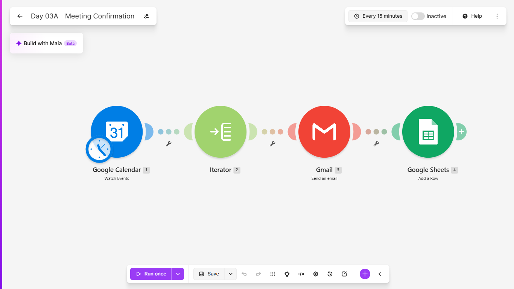
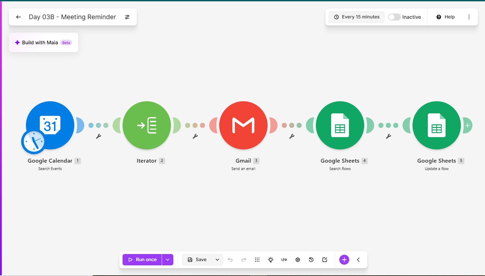
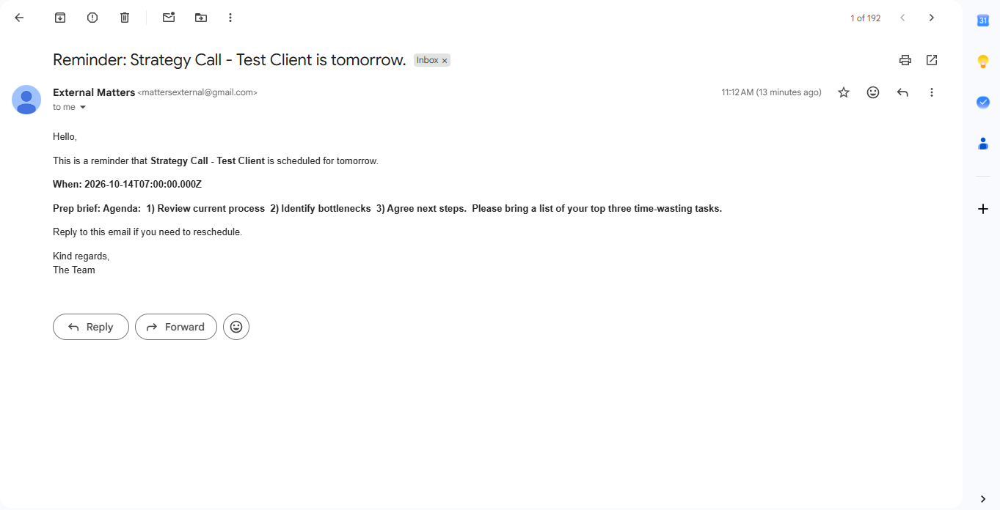
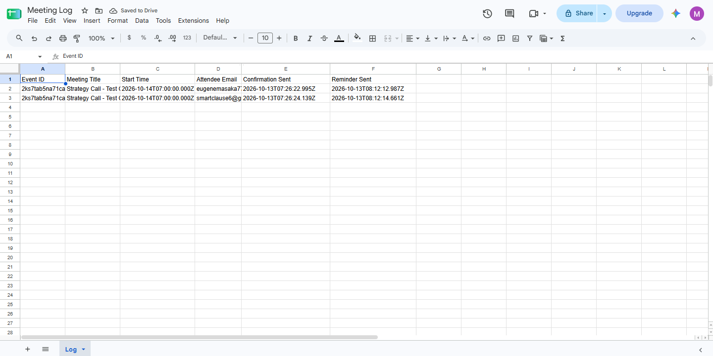

# Day 03: Meeting Confirmations and Reminders

## The problem
Meetings get booked and then forgotten, or attendees turn up
unprepared because nobody sent an agenda. Sending confirmations and
reminders by hand is easy to skip when things get busy.

## The solution
Two Make.com scenarios working together.

**Scenario A: Confirmation (runs every 15 minutes)**
1. Detects a newly created event on a dedicated Google Calendar
2. Splits the guest list so every attendee is handled separately
3. Emails each guest a confirmation with the meeting time in local
   time and the agenda from the event description as a prep brief
4. Logs one row per guest in a Google Sheet

**Scenario B: Reminder (runs daily at 09:00)**
1. Finds every meeting happening tomorrow
2. Splits the guest list
3. Emails each guest a reminder with the time and prep brief
4. Records the reminder time against that guest's log row

## Tools used
Make.com, Google Calendar, Gmail, Google Sheets

## Scenario flow

## Result

## Lessons learned
- A calendar event's guest list is an array. Mapping the first guest
  only would silently skip everyone else, so an Iterator turns each
  guest into their own bundle.
- When updating a row found by Search Rows, the "Row number" item must
  be mapped. Mapping a column value instead fails when it is empty.
- A search window with the same start and end date is zero hours wide
  and finds nothing. "Tomorrow" needs a start of +1 day and an end
  of +2 days.

## What I'd add next
- Include a video-call link in the confirmation
- A reschedule button that updates the calendar event
- A follow-up email the day after the meeting
- SMS or WhatsApp reminders in addition to email

## Setup
Import both blueprints into Make, reconnect your own Google accounts,
create a dedicated "Client Meetings" calendar and a log sheet with the
columns Event ID, Meeting Title, Start Time, Attendee Email,
Confirmation Sent, Reminder Sent, then point the modules at them.
