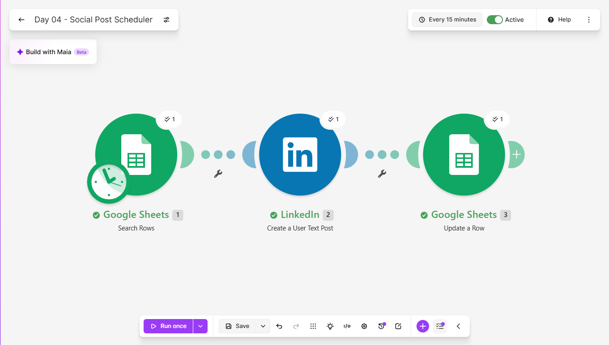
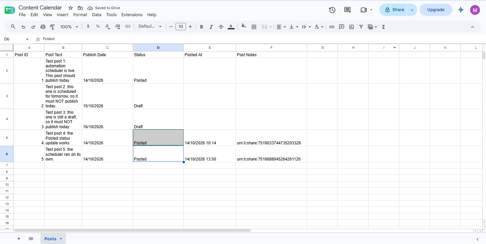
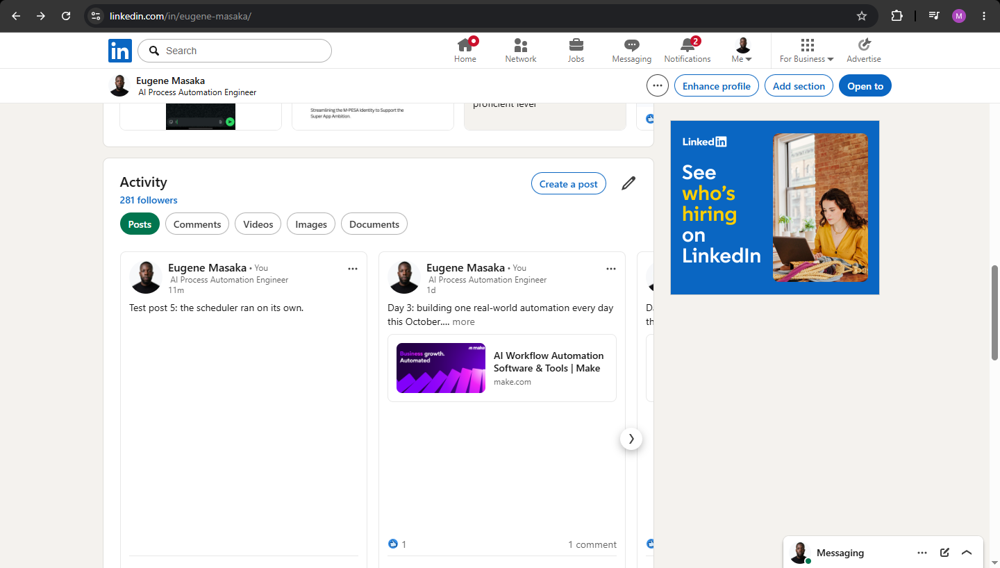

# Day 04: Social Post Scheduler

## The problem
Posting consistently is hard when content lives in scattered notes
and someone has to remember to publish it on the right day. Missed
days break momentum, and manual posting wastes time.

## The solution
A Make.com scenario that runs every day at 09:00 and treats a Google
Sheet as the content calendar. It:
1. Searches the sheet for rows that are marked "Ready" and dated today
2. Publishes each matching post to LinkedIn
3. Marks the row "Posted" with a timestamp
4. Stores the LinkedIn post ID against the row for reference

Posts with a future date or a "Draft" status are ignored, and posts
already marked "Posted" are never published twice.

## Tools used
Make.com, Google Sheets, LinkedIn

## Scenario flow

## Result

## Lessons learned
- Date comparison is the fragile part. Dates stored as plain text in
  the sheet are compared against today's date formatted to match,
  so the formats have to agree exactly.
- In Make's mapping panel, text inside formatDate() must be typed
  without quotation marks and with no comma after the opening bracket.
- When updating the row found by Search Rows, the row number item must
  be mapped. Mapping a column value instead fails when it is empty.
- Writing "Posted" back to the sheet is what stops duplicates. Without
  that step, every run would publish the same post again.

## What I'd add next
- Image support for posts
- Posting to more than one platform from the same row
- An email summary of what was published each day
- A weekly warning when the calendar has no upcoming posts

## Setup
Import `social-post-scheduler.json` into Make, reconnect your own
Google and LinkedIn accounts, and create a sheet with the columns
Post ID, Post Text, Publish Date, Status, Posted At, Post Notes. Store
dates as plain text in DD/MM/YYYY format and point the modules at
your own sheet.
