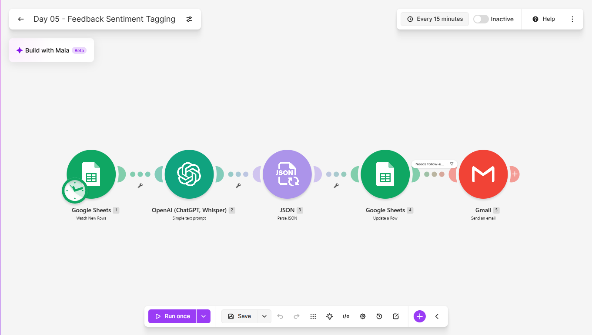
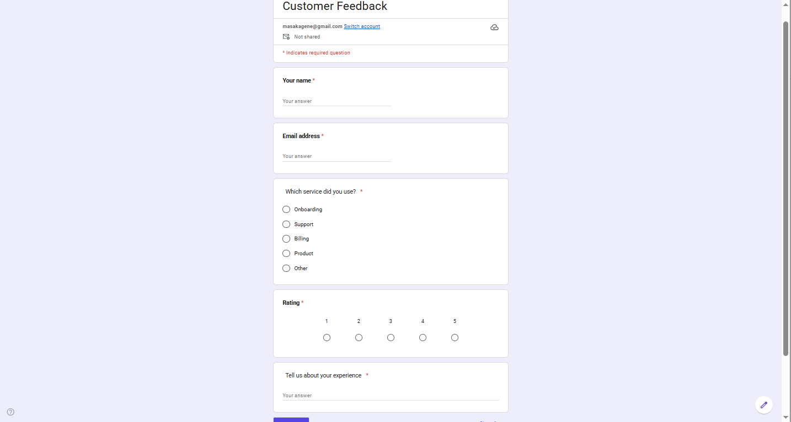
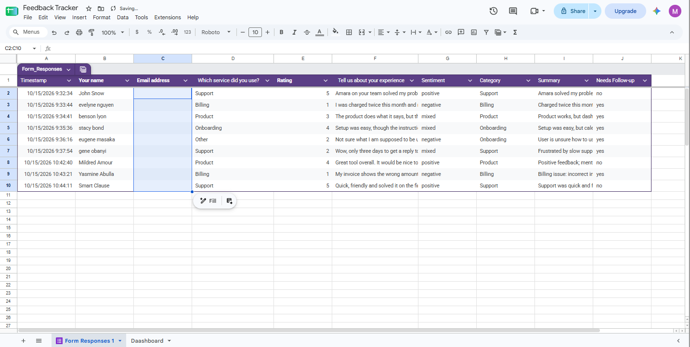
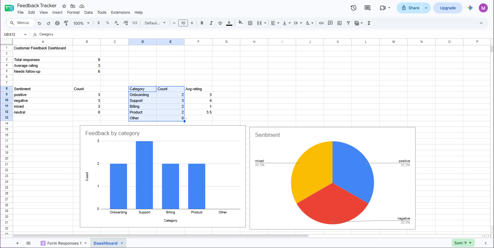
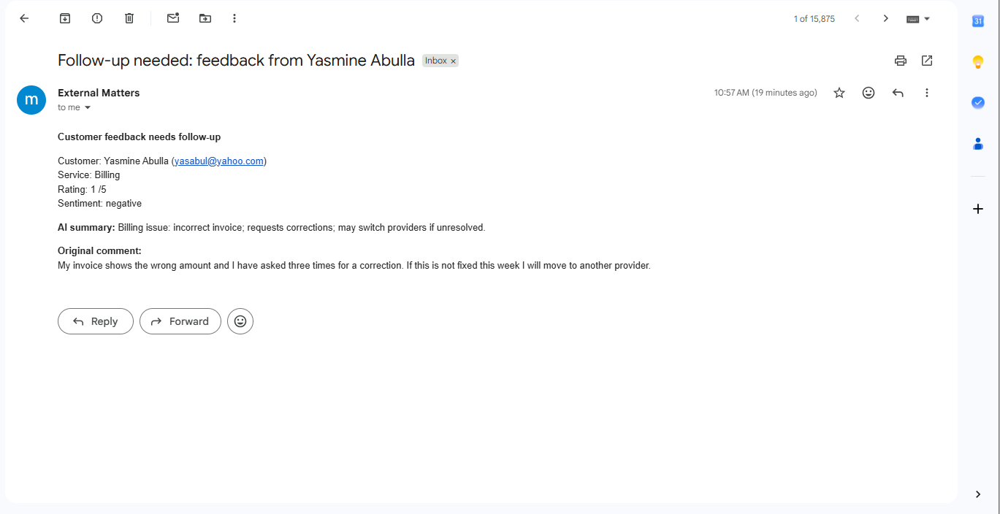

# Day 05: Customer Feedback Sentiment Tagging

## The problem
Businesses collect customer feedback and then never read all of it.
Complaints get buried, trends go unnoticed, and nobody sees the
pattern until customers have already left.

## The solution
A Make.com scenario that reads every new feedback response and:
1. Detects the new row in a Google Sheet filled by a feedback form
2. Sends the comment, rating and service to an AI model, asking for
   sentiment, category, a one-line summary and a follow-up flag
3. Parses the AI's JSON answer into separate fields
4. Writes the four values back into the same row
5. Emails the owner only when the response needs follow-up

A dashboard tab built from formulas updates itself with total
responses, average rating, sentiment split and category breakdown.

## Tools used
Make.com, Google Forms, Google Sheets, OpenAI (GPT-5 nano), Gmail

## Scenario flow

## Form

## Result

## Lessons learned
- Asking the model for a single JSON object and parsing it with a
  Parse JSON module gives separate, usable fields instead of one block
  of text.
- The classifier handled sarcasm well. A polite closing line in an
  otherwise negative review came back as "mixed", not positive.
- My first prompt flagged five of six responses for follow-up, which
  would train an owner to ignore alerts. Restricting the rule to
  customers who are upset, at risk of leaving, or blocked by a problem
  made the alerts meaningful.
- Pills must come from the right module. Customer fields come from the
  sheet trigger and AI fields from Parse JSON. Mapping from the wrong
  module left the fields blank without any error.

## What I'd add next
- A Slack or WhatsApp alert for urgent complaints
- Weekly trend email comparing sentiment to the previous week
- Automatic draft replies to unhappy customers for human approval
- Language detection for non-English feedback

## Setup
Import `feedback-sentiment-tagging.json` into Make, reconnect your own
Google and OpenAI accounts, create a feedback form linked to a sheet
with four extra columns named Sentiment, Category, Summary and Needs
Follow-up, and point the modules at your own sheet.
