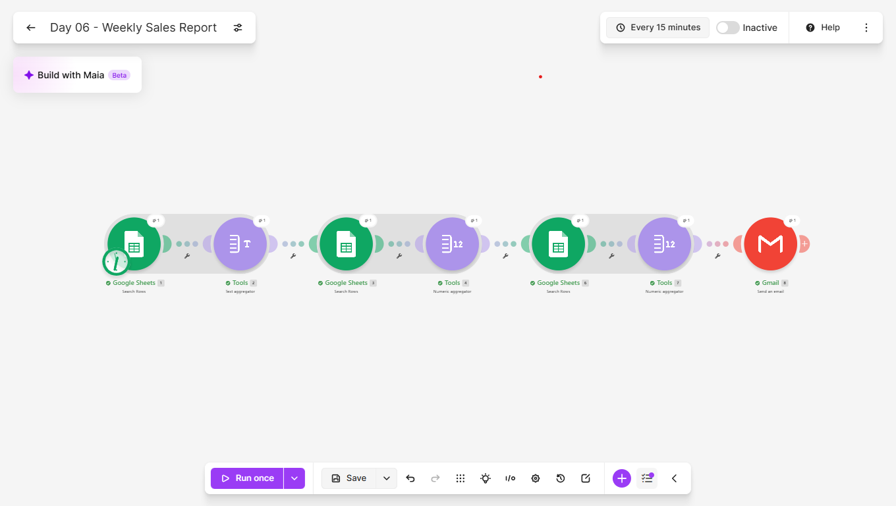
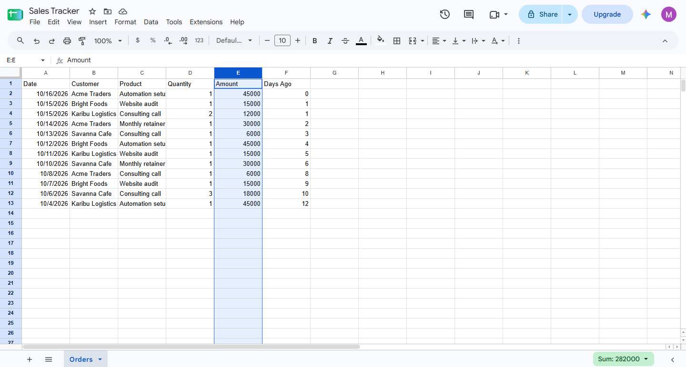
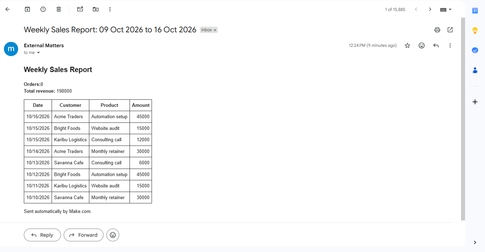
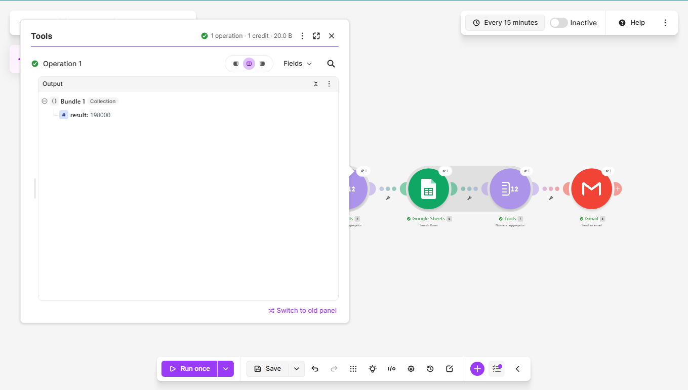
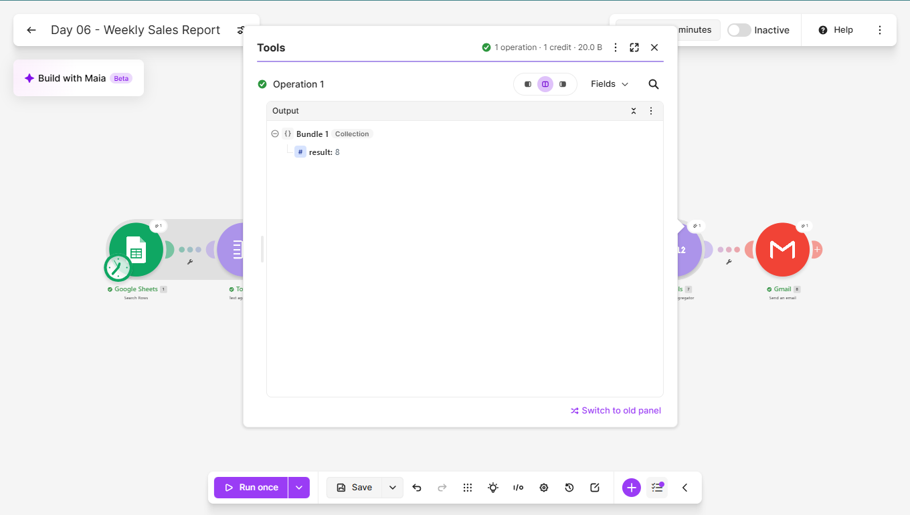
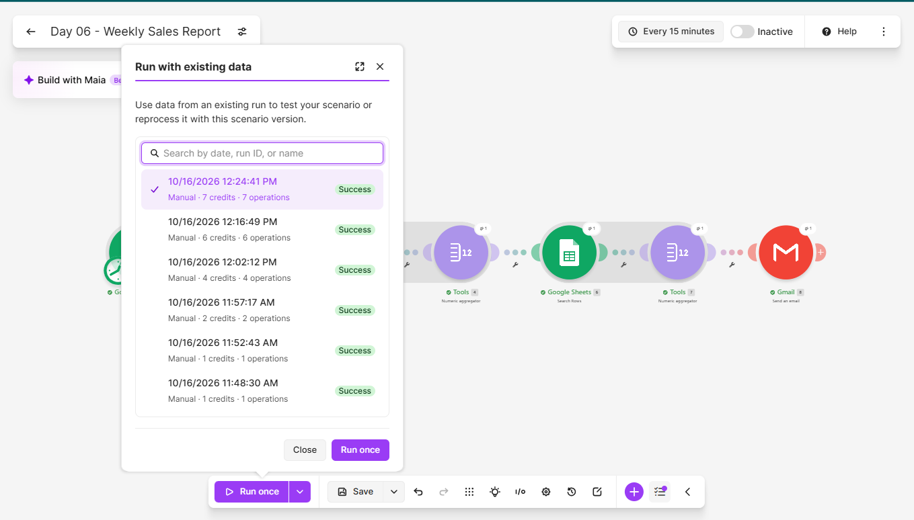

# Day 06: Weekly Sales Report

## The problem
Owners who track sales in a spreadsheet end up building the same
weekly summary by hand, or skipping it altogether. The numbers exist,
but nobody has time to turn them into something readable.

## The solution
A Make.com scenario that runs every Monday at 08:00 and:
1. Reads the last 7 days of orders from a Google Sheet
2. Builds an HTML table of those orders
3. Calculates total revenue and the number of orders
4. Emails a formatted report with the date range, the totals and
   the order table

## Tools used
Make.com, Google Sheets, Gmail

## Scenario flow

## Result

## How the totals are calculated
Make allows one aggregator per stream of bundles, so the scenario
uses a Text aggregator for the order table and two Numeric
aggregators for the figures.

**Total revenue** uses the SUM function on the Amount column:

**Order count** uses the COUNT function on the row numbers:

## Proof it runs unattended
The History tab shows a scheduled run that I did not start by hand:

## Lessons learned
- A helper column in the sheet (Days Ago, calculated from today's
  date) turns "last 7 days" into a plain number comparison. That is
  far less fragile than formatting dates inside Make.
- A number formatted with thousands separators reaches Make as text
  like "15,000.00", which breaks addition. Formatting the column as
  a plain number fixed it.
- An aggregator collapses many bundles into one and hides the output
  of every module before it. My order count disappeared downstream, so
  I re-read the sheet and used a second aggregator set to COUNT. The
  same pattern works for SUM.
- Both numeric aggregators output a field called "result". They are
  told apart by module number, so I checked each pill's value in the
  mapping panel (198000 for revenue and 8 for the count).
- The email body type must be raw HTML, or the table shows as tags.

## Known limitation
In a week with no orders, the first search returns nothing and the
scenario stops, so no email is sent. A zero-sales week should still
produce a report.

## What I'd add next
- Send a "no orders this week" report instead of staying silent
- Revenue by product and by customer
- Comparison against the previous week
- A chart image embedded in the email

## Setup
Import `weekly-sales-report.json` into Make, reconnect your own
Google accounts, and create a sheet with the columns Date, Customer,
Product, Quantity, Amount and Days Ago. Put this formula in F2:
=ARRAYFORMULA(IF(A2:A="","",TODAY()-A2:A))
Format the Amount column as a plain number with no separators, and
point the modules at your own sheet.
