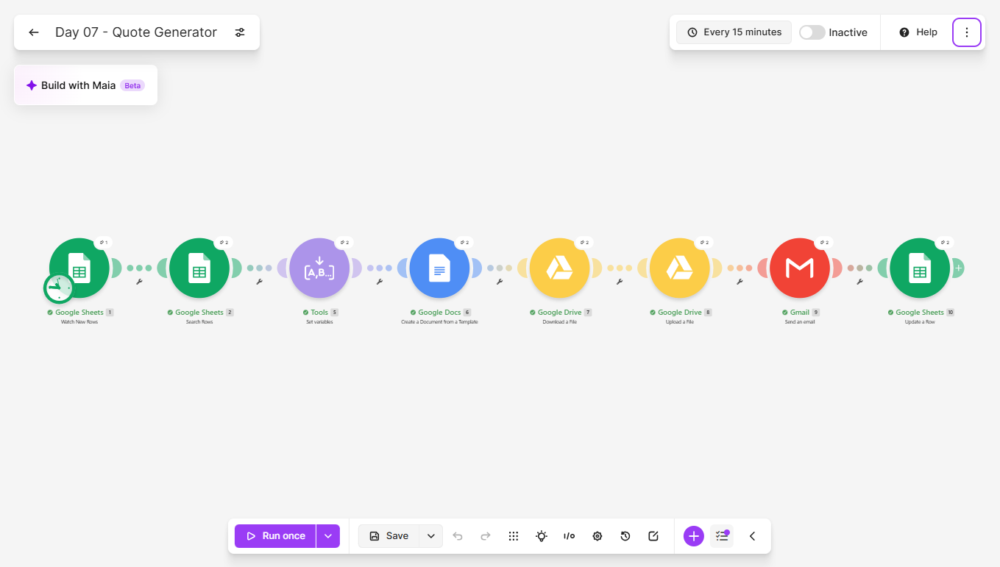
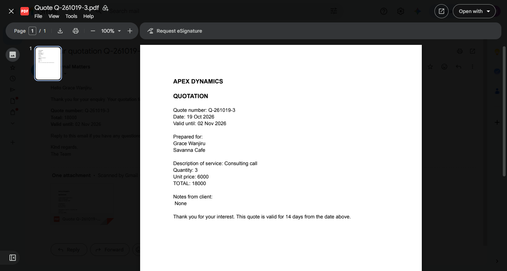
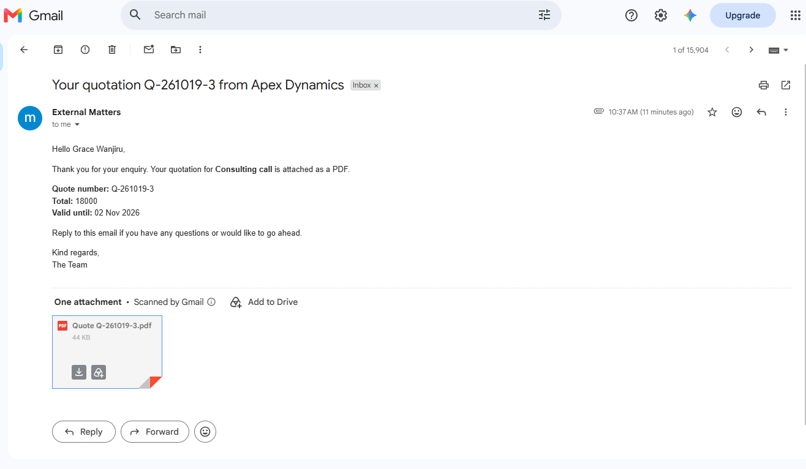
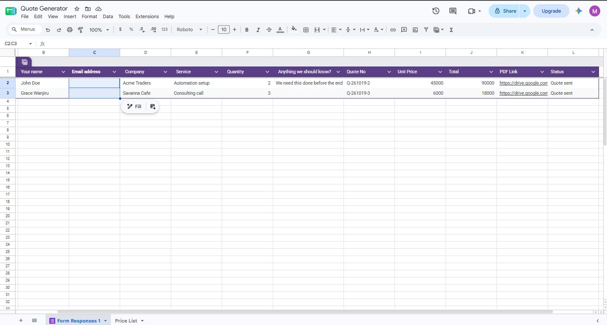
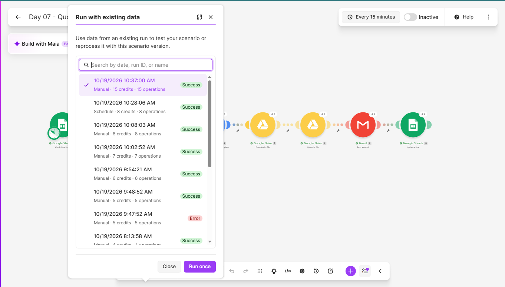

# Day 07: Client Quote Generator

## The problem
Freelancers and small agencies lose hours rewriting the same quote
document, and slow quotes lose deals. A client who waits two days for
a number often goes with whoever replied first.

## The solution
A Make.com scenario that turns a form submission into a finished,
emailed PDF quote within minutes. It:
1. Detects a new request in a Google Sheet filled by a quote form
2. Looks up the unit price for the chosen service in a price list
3. Calculates the total, the quote number and a 14-day expiry date
4. Fills a Google Doc template with the client's details
5. Converts the document to a PDF and saves it in a Drive folder
6. Emails the PDF to the client with a summary
7. Logs the quote number, price, total, PDF link and status in the sheet

## Tools used
Make.com, Google Forms, Google Sheets, Google Docs, Google Drive, Gmail

## Scenario flow

## Result

## Proof it runs unattended
The History tab shows a scheduled run that I did not start by hand:

## Lessons learned
- The client never types a price. A Price List tab is searched by the
  service name, so prices are changed in one place and the form can't
  be used to quote the wrong amount.
- Dates and the quote number are built in a Set variables module.
  When formatDate() was typed straight after other text, Make stored
  it as plain text instead of running it. Inserting the function from
  the mapping panel fixed it.
- A month format of MM gives "10" while MMM gives "Oct". The quote
  date showed a number until I corrected it.
- A blank optional field needs a fallback. ifempty() puts "None" in
  the notes line, so the document never shows an empty gap.
- The PDF contents come from the Download a File module, not from the
  upload step, which only outputs a link. Mapping the attachment from
  the wrong module is the easiest way to send a corrupted file.
- Prices stored with thousands separators arrive as text such as
  "45,000". A plain number format avoids it.

## Known limitation
If a service in the form does not exactly match a name in the Price
List, the price lookup returns nothing and the scenario stops
silently: no quote is sent and nobody is told. A "no price found"
alert to the owner would close that gap.

## What I'd add next
- An alert when no price is found
- Several line items on one quote
- A "Mark as accepted" link that updates the sheet and notifies me
- Automatic follow-up email if the quote isn't answered in 5 days
- Tax or discount lines driven by the price list

## Setup
Import `quote-generator.json` into Make and reconnect your own Google
and Gmail accounts. Create a form linked to a sheet with the columns
Quote No, Unit Price, Total, PDF Link and Status after the form
columns, a Price List tab (Service, Unit Price with plain number
format), a Google Doc template using the placeholders
{{quote_number}}, {{date}}, {{valid_until}}, {{client_name}},
{{company}}, {{service}}, {{quantity}}, {{unit_price}}, {{total}} and
{{notes}}, and a Drive folder for the generated quotes. Point the
modules at your own files.
