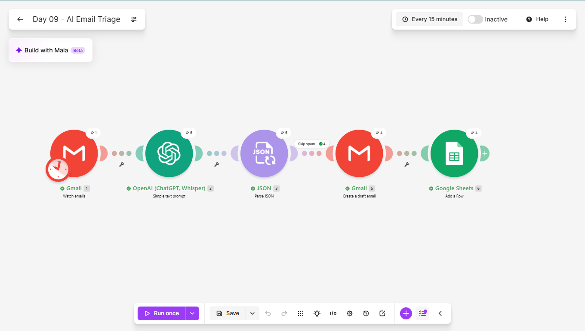
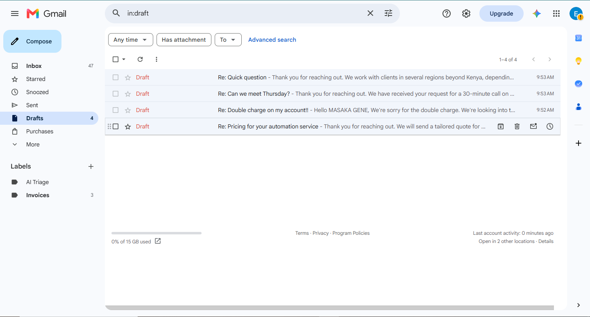
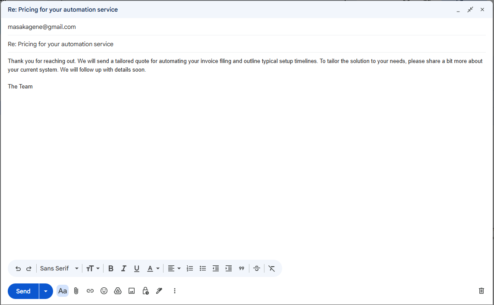
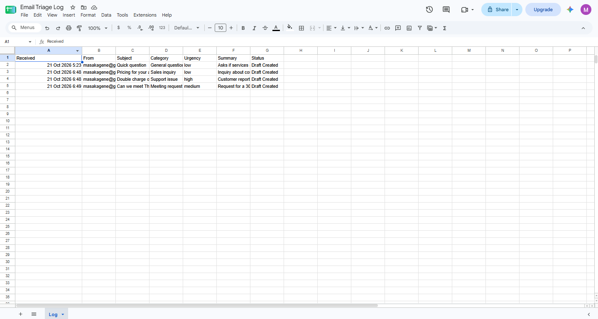
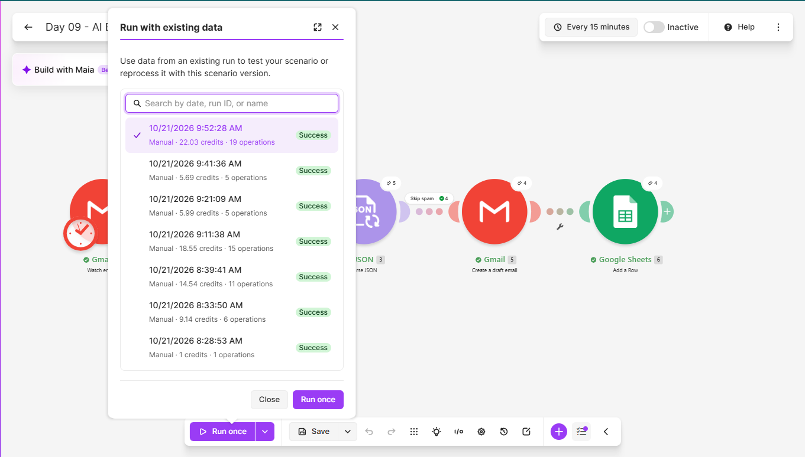

# Day 09: AI Email Triage

## The problem
A busy inbox mixes real customers, urgent problems, meeting requests
and noise. Reading everything to decide what matters, then writing
the same routine replies, eats the start of every working day.

## The solution
A Make.com scenario that reads labelled incoming emails and, for
each one:
1. Sends the sender, subject and body to an AI model
2. Gets back a category, an urgency level, a one-line summary and a
   draft reply, as a single JSON object
3. Parses that JSON into separate fields
4. Skips spam entirely
5. Creates a reply draft in Gmail for a human to review and send
6. Logs the email, category, urgency and summary in a Google Sheet

Nothing is ever sent automatically. A person approves every reply.

## Tools used
Make.com, Gmail, OpenAI (GPT-5 nano), Google Sheets

## Scenario flow

## Result

## Proof it runs unattended
The History tab shows a scheduled run that I did not start by hand:

## Lessons learned
- Drafts, not sends. Creating drafts keeps a human in the loop, which
  is the right design for anything customer-facing. The AI saves the
  typing, and a person still owns the decision.
- The prompt is the safety layer. The drafting rules forbid stating a
  price, deadline or discount, forbid accepting a specific meeting
  time, and forbid asking for card details or passwords. The pricing
  test email got a reply promising a tailored quote and no number.
- Asking for a single JSON object and parsing it gives separate,
  usable fields. Anything wrapped in extra text would break the parser.
- Urgency needs a tight definition. Limiting "high" to payment
  disputes, threats to leave and time-critical requests kept it from
  flagging everything.
- A filter after the parser keeps spam out of the drafts folder.
- This version of the Gmail draft module offers only Raw HTML or
  Collection of contents for the body. Collection of contents kept the
  text readable.
- The scenario reads only emails carrying a label, so it never touches
  private mail. Applying the label by hand suits testing, and a Gmail
  filter on a plus-address can apply it automatically.

## Known limitations
- Line breaks inside the draft collapse, so the sign-off sits at the
  end of the paragraph. It is cosmetic, because every draft is edited
  before sending.
- Drafts are separate messages, not attached to the original thread,
  which is why the subject starts with "Re:".
- Spam is skipped before logging, so it does not appear in the sheet.
- Email text is sent to an AI provider, so this suits low-sensitivity
  correspondence only. Confidential or privileged material needs a
  provider and data terms chosen for it.

## What I'd add next
- Thread the draft onto the original email
- Route high-urgency emails to an instant alert
- Learn from edits: log what I changed before sending
- Add a draft-quality score so weak replies get flagged
- Count blocked spam in a weekly summary

## Setup
Import `ai-email-triage.json` into Make and reconnect your own Gmail,
Google Sheets and OpenAI accounts. Create a Gmail label named
"AI Triage" and a sheet with the columns Received, From, Subject,
Category, Urgency, Summary and Status. Apply the label to the emails
you want triaged, or set up a filter to do it automatically.
