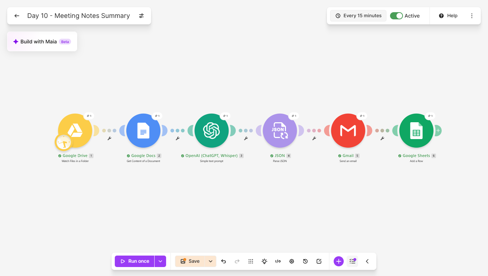
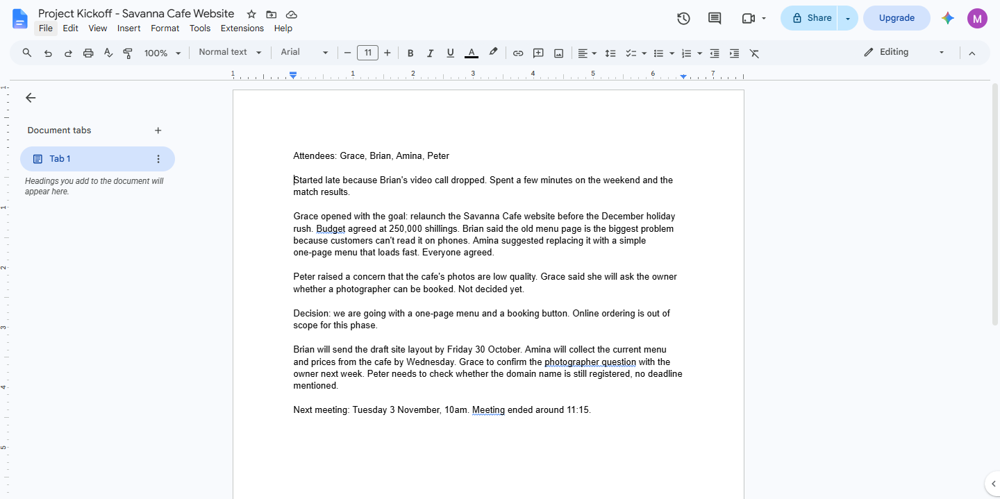
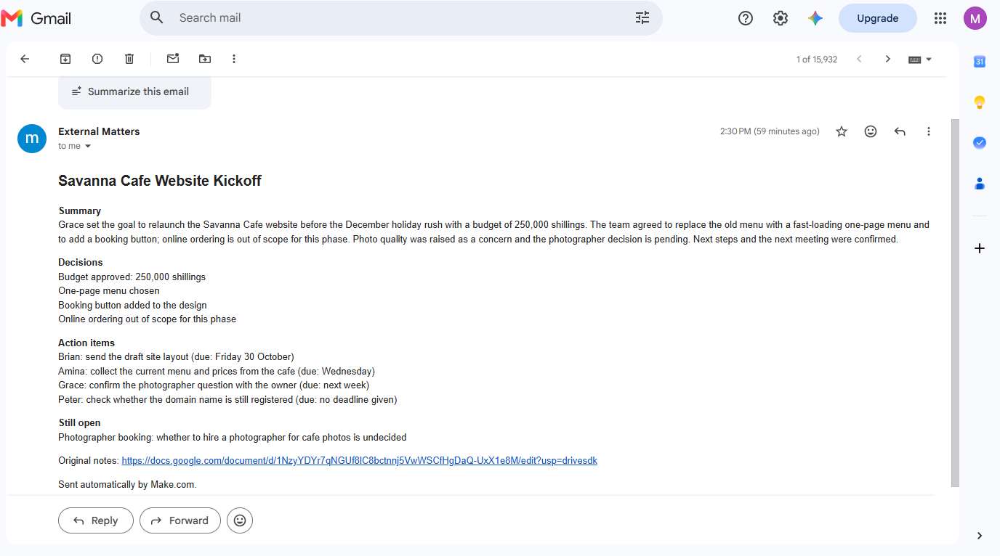
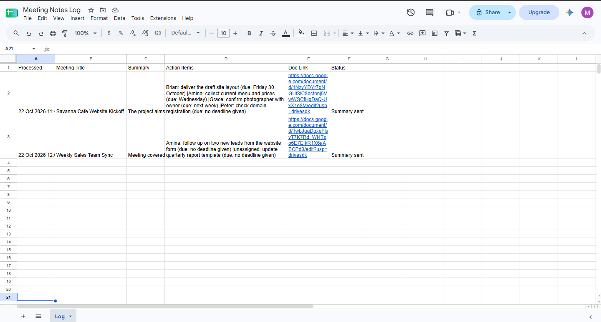
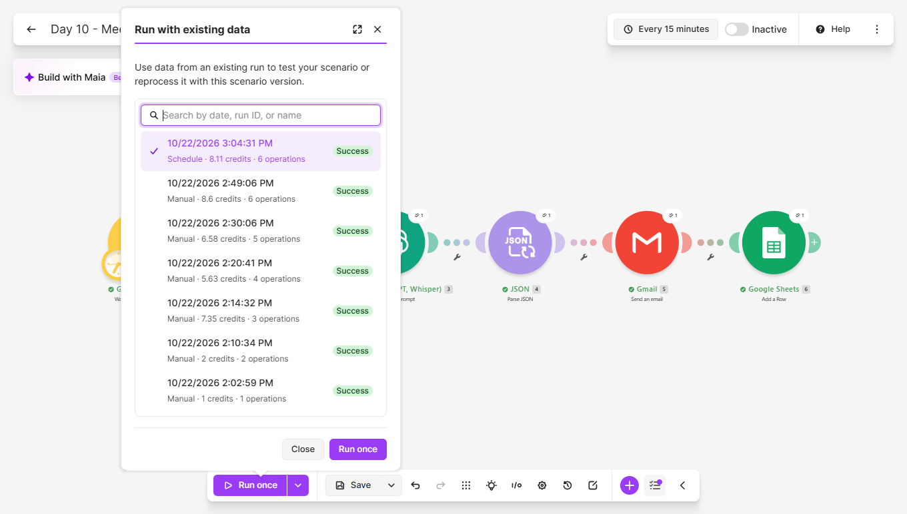

# Day 10: Meeting Notes to Summary and Action Items

## The problem
After a meeting, someone has to turn rambling notes into a summary
and a list of who does what by when. It is tedious, so it often
doesn't happen, and tasks get forgotten.

## The solution
A Make.com scenario that watches a Google Drive folder. When a notes
document lands in it, the scenario:
1. Reads the full text of the document
2. Sends it to an AI model, asking for a title, a short summary, the
   decisions made, the action items with owners and deadlines, and
   the questions left open
3. Parses the single JSON answer into separate fields
4. Emails a formatted summary
5. Logs the meeting, summary, action items and a link to the notes in
   a Google Sheet

## Tools used
Make.com, Google Drive, Google Docs, OpenAI (GPT-5 nano), Gmail,
Google Sheets

## Scenario flow

## Input and output
Raw notes, with small talk, a dropped call and tasks buried in the
text:

The summary the scenario produced:

## Meeting log

## Proof it runs unattended
The History tab shows a scheduled run that I did not start by hand:

## Lessons learned
- The Drive trigger only returns a file's name and ID. A separate
  Google Docs module reads the text inside.
- Watching for newly created files, not modified ones, stops the
  scenario re-running every time someone edits a notes document.
- "Never invent" has to be written into the prompt. Without it, a
  task with no deadline gets an invented date. With it, the output
  reads "due: no deadline given" and "Owner: unassigned".
- Splitting decisions from open questions matters. Something merely
  discussed was kept out of the decisions list and listed as open.
- My first prompt let the summary repeat the action items and the next
  meeting. One rule fixed it, and a second rule moved agreed budgets
  into the decisions.
- The AI returns line breaks as   marks. They render properly in an
  HTML email, but in a spreadsheet cell they show as raw text, so a
  replace function swaps them for a separator before logging.
- A second, deliberately vague set of notes tested the opposite case:
  a meeting where nothing was decided and one task had no owner.

## Known limitations
- Relative dates such as "Wednesday" or "next week" are copied as
  written. Read a month later they are ambiguous. Passing the meeting
  date into the prompt would let the AI write real dates.
- The scenario reads Google Docs only. Notes in an email, a PDF or an
  audio recording are not processed.
- Meeting notes are often confidential and their text is sent to an AI
  provider. Real use needs a provider and data terms chosen for it.
- The summary is emailed to me, not to the attendees.

## What I'd add next
- Email the summary to the attendees, with a review step first
- Pass in the meeting date so deadlines become real dates
- Transcribe audio recordings, then summarise them
- Create each action item as a task in a task manager
- Send each owner only their own action items

## Setup
Import `meeting-notes-summary.json` into Make and reconnect your own
Google and OpenAI accounts. Create a Drive folder to watch and a sheet
with the columns Processed, Meeting Title, Summary, Action Items,
Doc Link and Status. Point the modules at your own folder and sheet,
then drop a notes document into the folder.
