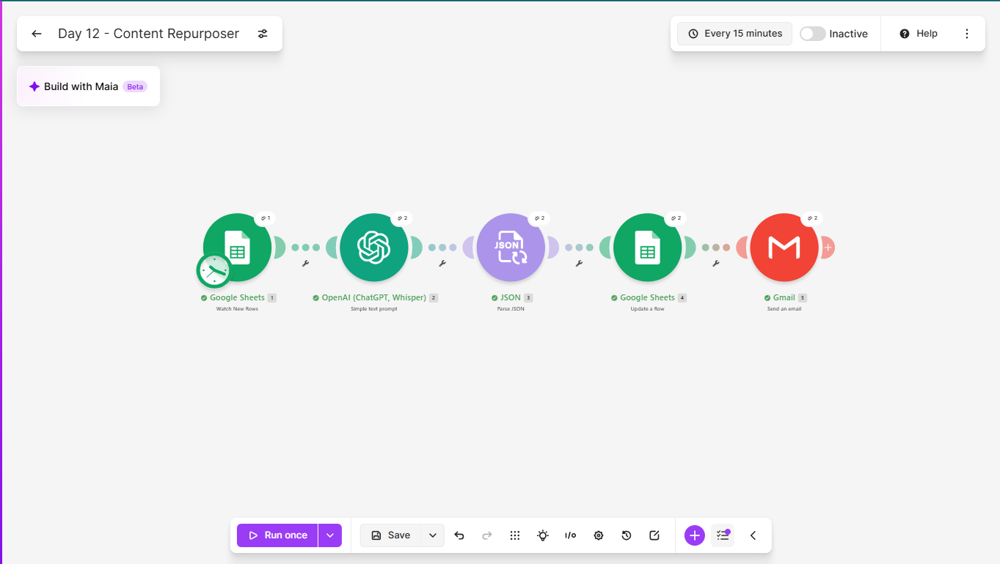
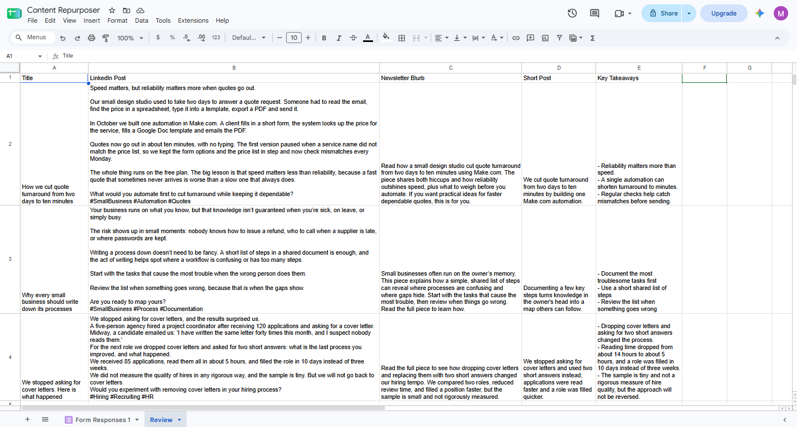
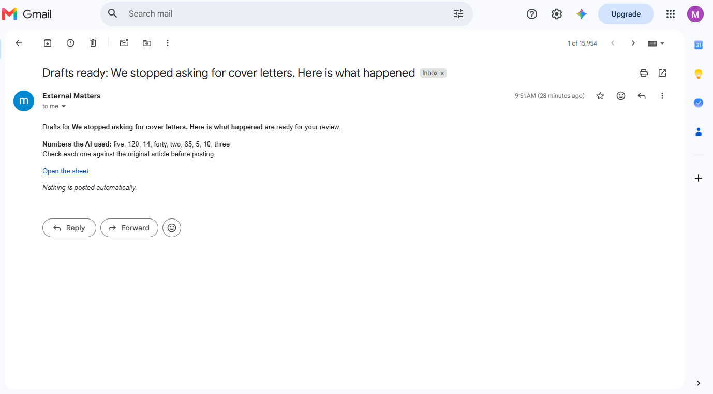
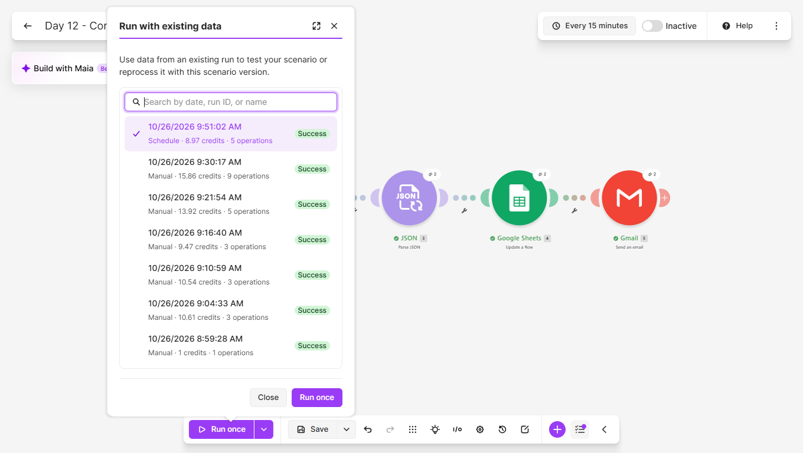
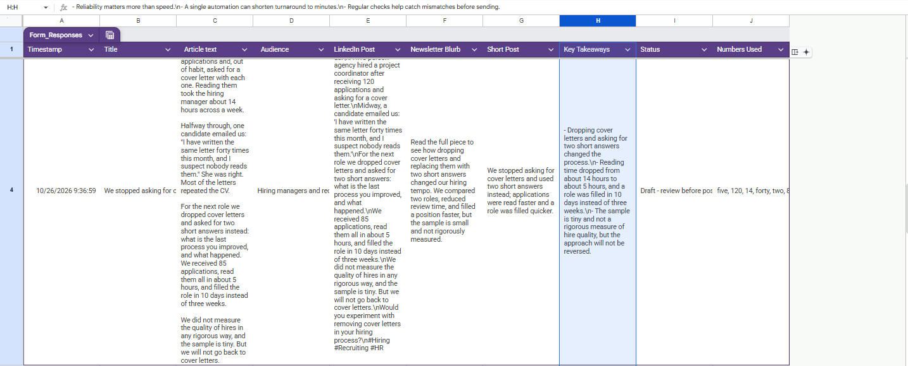

# Day 12: Content Repurposer

## The problem
Writing something once and then rewriting it for every channel is
slow, so most people post once and stop. The article goes out and the
rest of its value is never used.

## The solution
A Make.com scenario that turns one article into several drafts. When
an article is submitted through a form, it:
1. Sends the title, audience and text to an AI model
2. Gets back a LinkedIn post, a newsletter blurb, a short post, three
   key takeaways and a list of every number the drafts use
3. Parses that single JSON answer into separate fields
4. Saves the drafts in the sheet beside the original article, marked
   "Draft - review before posting"
5. Emails a notification listing the numbers the AI used, so they can
   be checked against the article

Nothing is posted automatically. A person reviews every draft.

## Tools used
Make.com, Google Forms, Google Sheets, OpenAI (GPT-5 nano), Gmail

## Scenario flow

## Result

## Proof it runs unattended
The History tab shows a run that picked up a new article without me
starting it:

## The hard test: a quote, a hedge and many numbers
The third test article contained a direct quote from a job candidate,
the author's own caution ("the sample is tiny"), and figures for
applications, hours and days. It checked three things.

- The quote survived word for word. Its quotation marks became single
  quotes, because the prompt forbids double quotes inside the JSON.
- The author's caution survived in the LinkedIn post, the newsletter
  blurb and the takeaways. The short post dropped it, though it made
  no stronger claim.
- Every number matched the article: 120 applications, about 14 hours,
  85 applications, about 5 hours, 10 days and three weeks. None were
  invented.

Two things still needed a human eye:
- One takeaway says reading time dropped from about 14 hours to
  about 5 hours. That compares 120 applications with 85, so a reader
  could take more from it than the data supports. The drafts repeat
  the article's own framing.
- The newsletter blurb says the team "compared two roles". The
  article describes two hires, not a comparison, so this is a mild
  embellishment.

## How the prompt changed
Three versions were tested. The raw outputs of the first two are in
[prompt-iterations.md](prompt-iterations.md).

Version 1 problems:
- Key takeaways came back as a list, which cannot go into one cell
- Hashtags sat in the middle of the LinkedIn post
- A short post said a result "proves" something the article never
  claimed
- One LinkedIn post copied the article's sentences almost word for
  word

Version 2 fixed those, then exposed new ones:
- A required field (the short post) disappeared, because my edit to
  the prompt removed its line
- The model added claims the article does not make, such as a
  takeaway about keeping a process up to date

Version 3 restored the short post and added a rule that every claim
must restate something the article says. It was then tested on the
harder third article above.

## Lessons learned
- A rule against inventing numbers worked. The article with no
  numbers produced drafts with no numbers. But it did not stop
  invented advice, so a separate rule was needed: every claim must
  restate something the article says.
- Asking the model to list the numbers it used is useful, but its list
  cannot be trusted on its own. In one run it listed a figure that the
  draft never used. It is a prompt to check, not a check.
- Overclaiming is the typical repurposing failure. Shorter formats
  push the model to strengthen a claim, so a short post said a result
  "proves" something. Banning words like "proves" and "guarantees"
  helped.
- The format has to be spelled out exactly. A key described as a
  string returned a list until the prompt said "a single string, not
  a list".
- Editing a prompt can silently remove a requirement. After every
  edit, count the keys in the output.
- Every prompt change was followed by a fresh test run, because the
  Parse JSON step needs the output shape to stay stable.
- The model kept a direct quote word for word and kept the author's
  caution in the longer formats, but the shortest format dropped the
  caution. The shorter the draft, the more a human needs to check.

## Known limitations
- A draft is only as faithful as the model. Every draft needs a human
  read against the original before it is posted, and the notification
  says so.
- The model can add small claims the article does not make, such as
  "compared two roles", even with a rule against it.
- A takeaway can restate a comparison without saying the two sides
  are not like for like.
- Line breaks arrive in the sheet as the characters \n, so the cells
  are awkward to read and copy. A review tab with a SUBSTITUTE formula
  displays them properly.
- Nothing is posted. Publishing is a separate step.

## What I'd add next
- A second AI pass that checks each draft against the article and
  flags any claim the article does not support
- Send approved drafts straight into the social post scheduler built
  on Day 4
- A tone setting per audience
- Compare drafts from two models side by side
- Convert the line breaks before the drafts reach the sheet

## Setup
Import `content-repurposer.json` into Make and reconnect your own
Google and OpenAI accounts. Create a form with the fields Title,
Article text and Audience, linked to a sheet that has the columns
LinkedIn Post, Newsletter Blurb, Short Post, Key Takeaways, Status
and Numbers Used after the form columns. Point the modules at your
own sheet.
