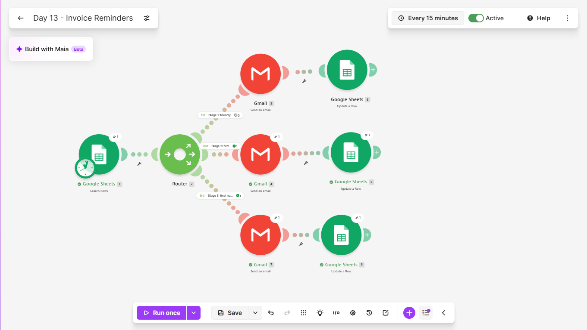
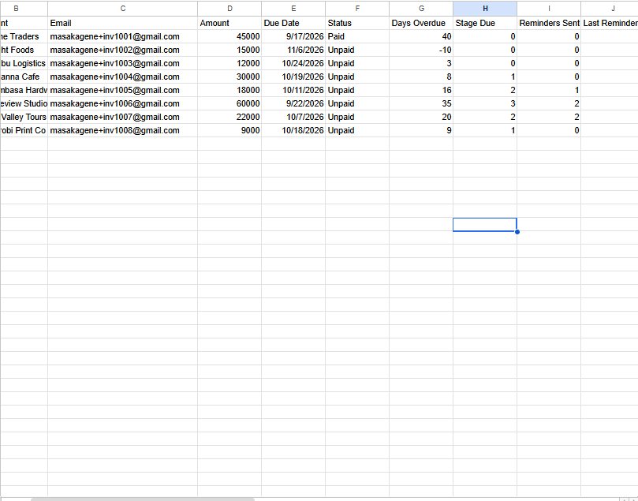
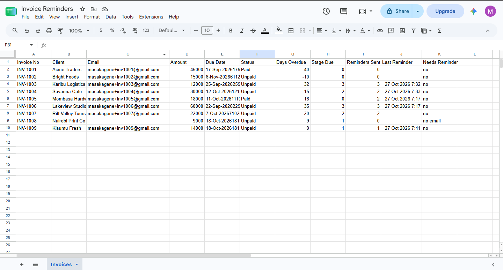
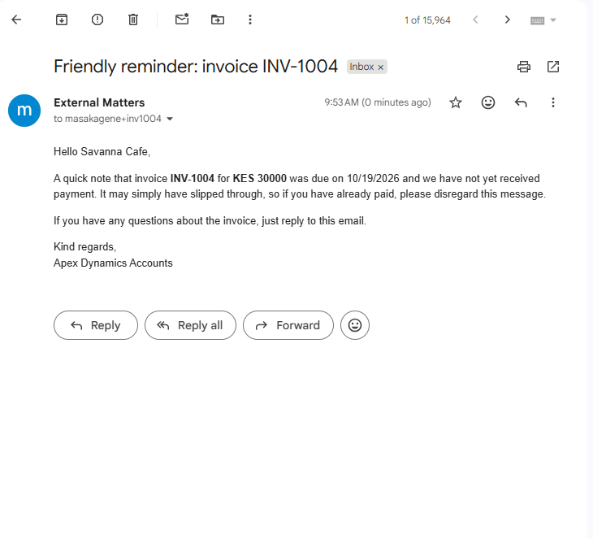
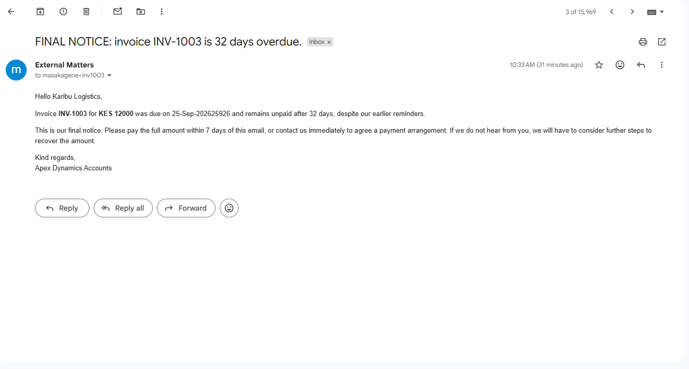
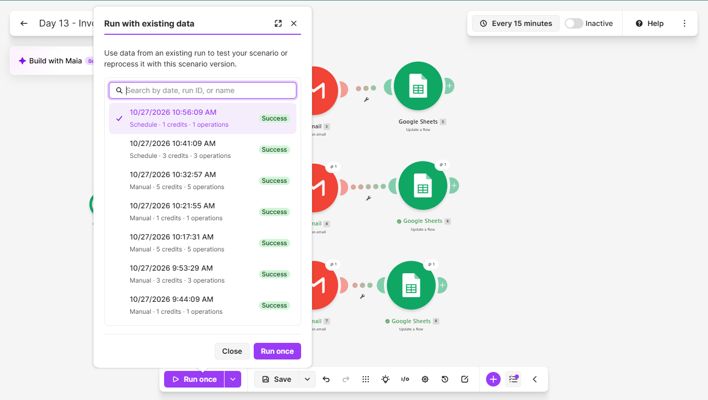

# Day 13: Overdue Invoice Reminders

## The problem
Chasing late payments is awkward, so it gets put off, and cash flow
suffers. When reminders do go out, they are inconsistent: one client
is chased at day 5, another at day 40, and some are chased twice.

## The solution
A Make.com scenario that runs every morning and works through a sheet
of invoices. Each invoice has a stage based on how overdue it is:

| Days overdue | Stage | Message |
|--------------|-------|---------|
| Under 7, or not yet due | 0 | None |
| 7 to 13 | 1 | Friendly reminder |
| 14 to 29 | 2 | Firm reminder |
| 30 or more | 3 | Final notice |
| Marked Paid | 0 | None |

The scenario:
1. Searches for invoices that need a reminder
2. Sends each one down the route for its stage, through a router
3. Emails the client in the right tone
4. Records the stage sent and the time, so nobody is reminded twice
   for the same stage

No AI is involved. It is plain logic and fixed templates, which keeps
it predictable.

## Tools used
Make.com, Google Sheets, Gmail

## Scenario flow

## Result
The test data before the first run, with fictional clients:

The sheet after the tests:

The tone of the reminders changes with the stage:

## Proof it runs unattended
The History tab shows a scheduled run that I did not start by hand:

## Safeguards I tested
- No repeats. Running the scenario twice in a row sent nothing the
  second time.
- Moving to the next stage. An invoice already reminded at stage 1
  was moved to 15 days overdue and received the firm reminder, and
  not a second friendly one.
- A missed run. An invoice moved to 32 days overdue received the
  final notice straight away, instead of waiting for an exact day.
- Payment. An invoice marked Paid received nothing, however overdue.
- A missing email address. The row is marked "no email" in the sheet
  and skipped.

## Lessons learned
- Triggering on an exact day (send at exactly 7 days) fails silently
  if a run is missed. Working out a stage and sending only when the
  stage is higher than the number already sent means a missed day
  causes a late reminder, never a missing one.
- Storing the highest stage sent in the row is what prevents repeats.
  It also lets one invoice skip stages safely.
- Make's search filter compares a column with a fixed value but not
  two columns with each other. A helper column in the sheet decides
  whether an invoice needs a reminder, and the scenario filters on
  that.
- A router with one numeric filter per stage keeps each message
  separate and easy to change. A row can only match one stage.
- Make passes a date exactly as the sheet displays it, so my first
  email showed a US-style date. Changing the sheet's date format
  fixed it.
- Test dates have to be stored as plain values, not formulas, or they
  move every day and the test data drifts.
- A daily run is enough, because an invoice cannot change stage more
  than once a day, and an empty run costs one operation.
- Mapping a row number, not a column value, is what makes the update
  hit the right row.

## Known limitations
- The scenario cannot tell whether a client has paid. If an invoice
  is not marked Paid, the client is reminded anyway. The wording
  asks them to disregard the message if they have paid.
- An invoice that has never been chased and is already 30 or more days
  overdue gets a final notice immediately. A first contact at that
  point probably deserves a human decision.
- A client who has replied or promised a date still gets the next
  stage on schedule.
- The wording and the currency are fixed. The final notice mentions
  further steps and should be checked against real contract terms
  before use.
- Part of the logic lives in the sheet's formulas, so the sheet has
  to be set up exactly as described.

## What I'd add next
- Stop reminders for a client who has replied
- An alert to me before any final notice is sent
- Cap the first reminder at stage 2 for invoices never chased
- A weekly summary of what is overdue and what was sent
- Read invoices from an accounting tool instead of a sheet

## Setup
Import `invoice-reminders.json` into Make and reconnect your own
Google accounts. Create a sheet with the columns Invoice No, Client,
Email, Amount, Due Date, Status, Days Overdue, Stage Due, Reminders
Sent, Last Reminder and Needs Reminder. Format Amount as a plain
number and Due Date as a date. Put these formulas in row 2:

Days Overdue (G2): =ARRAYFORMULA(IF(E2:E="","",TODAY()-E2:E))

Stage Due (H2): =ARRAYFORMULA(IF(E2:E="","",IF(F2:F="Paid",0,IF(G2:G>=30,3,IF(G2:G>=14,2,IF(G2:G>=7,1,0))))))

Needs Reminder (K2): =ARRAYFORMULA(IF(E2:E="","",IF(C2:C="","no email",IF(H2:H>I2:I,"yes","no"))))

Point the modules at your own sheet and adjust the wording and
currency in the three emails.
