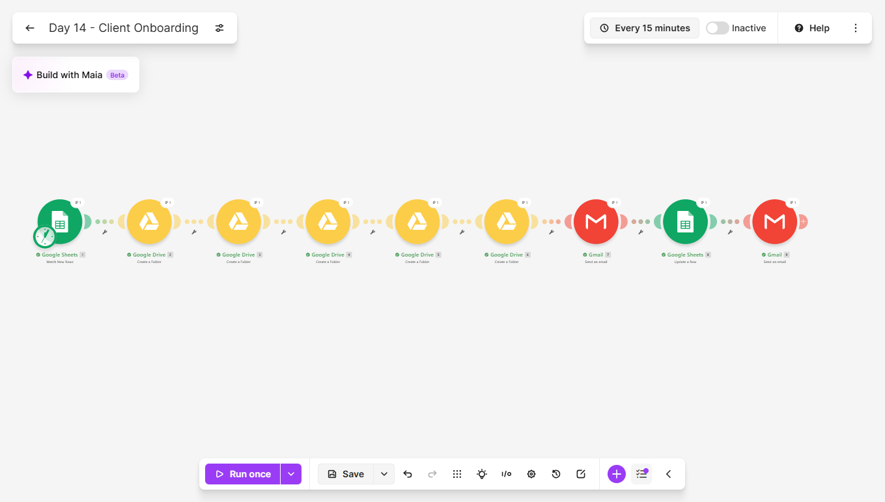
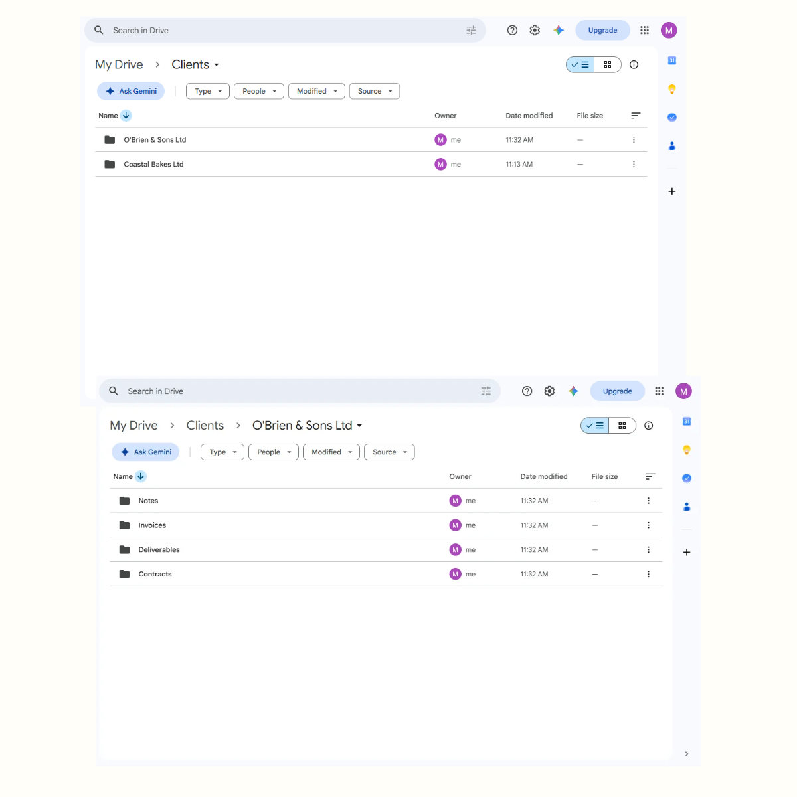
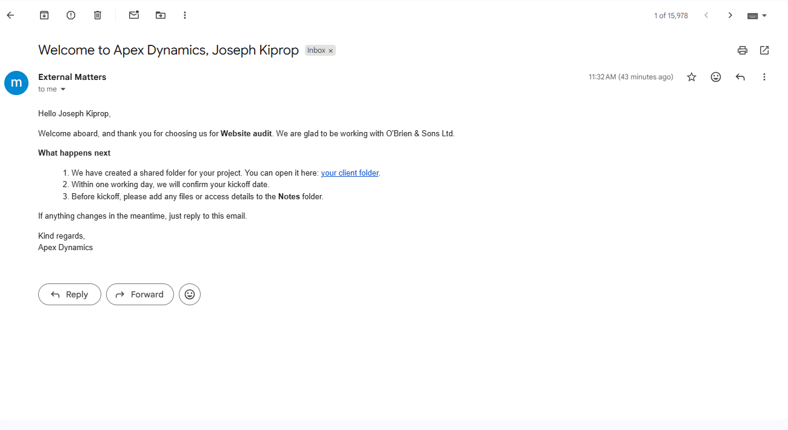
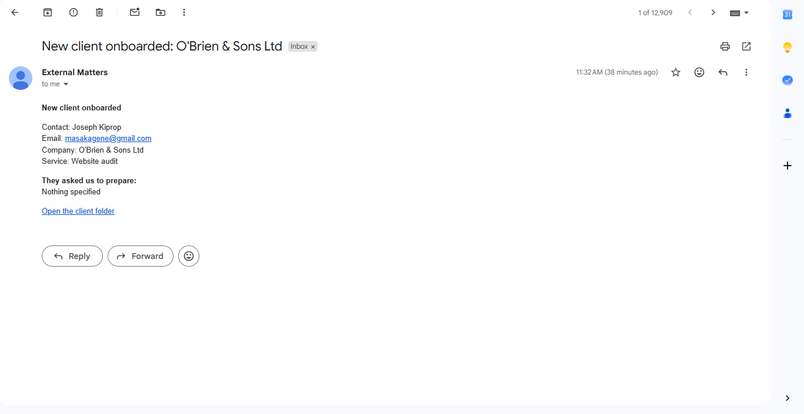
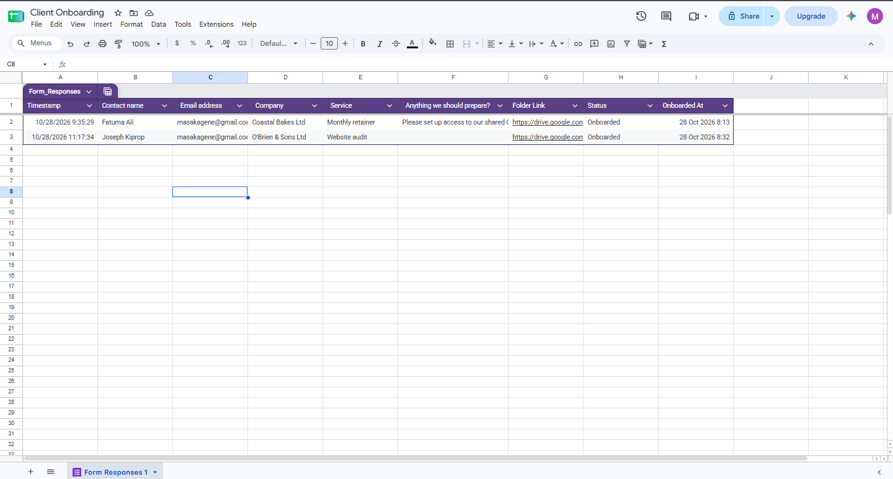
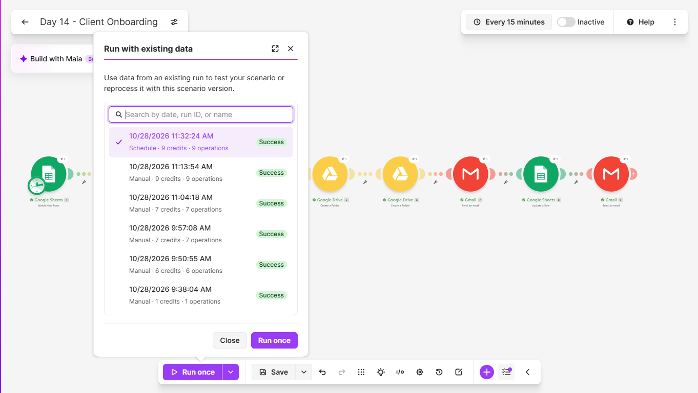

# Day 14: Client Onboarding Automation

## The problem
Onboarding a new client means the same chores every time: create a
folder, add the subfolders, send a welcome email, add them to a
tracker. Done by hand it is slow and inconsistent. One client gets a
tidy folder and a clear welcome, and the next gets nothing until
someone remembers.

## The solution
A Make.com scenario that sets a new client up as soon as they submit
a form. It:
1. Detects the new client in a Google Sheet filled by the form
2. Creates a folder named after the client's company
3. Creates four subfolders inside it: Contracts, Deliverables,
   Invoices and Notes
4. Emails the client a welcome message that names their service and
   links to their folder, with the next steps
5. Records the folder link, a status and a timestamp in the sheet
6. Emails me an alert with the client's details and anything they
   asked me to prepare

It pairs with the Day 7 quote generator. That project wins the work
and this one sets the client up once they say yes.

No AI is involved. It is plain logic and fixed templates.

## Tools used
Make.com, Google Forms, Google Sheets, Google Drive, Gmail

## Scenario flow

## Result
The folder structure created for each client:

The welcome email:

My alert:

The tracker:

## Proof it runs unattended
The History tab shows a scheduled run that I did not start by hand:

## Tests
- A first client with a note for me to act on
- A second client with an apostrophe and an ampersand in the company
  name, and no answer to the optional question. It tested special
  characters in a folder name and an email, and the "Nothing
  specified" fallback in my alert

## Lessons learned
- The subfolders have to use the client folder's ID as their parent,
  mapped from the earlier module. Picking the Clients folder from a
  list would put them beside the client folder, not inside it.
- Typing a long HTML email body into Make in pieces can silently drop
  a section. My first welcome email had lost a whole paragraph, and I
  only noticed by reading the delivered email. Every template is now
  checked by receiving it, not by reading the module.
- "Run this module only" re-sends one email using the last run's data,
  so an email can be tested again without creating more folders.
- Optional form fields need a fallback. An empty value is replaced
  with "Nothing specified", so the alert never shows a blank gap.
- Each run creates real folders, so test runs leave clutter. Deleting
  the duplicates after every test kept the Drive tidy.
- Mapping the row number, not a column value, is what makes the
  update hit the right row.

## Known limitations
- Onboarding the same company twice would create a second folder with
  the same name. Drive allows it, and the scenario does not check.
- The folder is not shared with the client. The link in the welcome
  email only opens for someone who already has access, so real use
  needs a share step.
- Anyone with the form link can trigger a folder and a welcome email
  to any address they type. A real version needs a check that the
  person is actually a client.
- If folder creation partly fails, the welcome email can still go out.

## What I'd add next
- Share the client folder with the client's email automatically
- Check whether a folder for the company already exists
- Copy a set of template documents into the Contracts folder
- Create a kickoff event in Google Calendar
- Hold the welcome email until I approve the client

## Setup
Import `client-onboarding.json` into Make and reconnect your own
Google accounts. Create a parent Drive folder for clients and a form
with the fields Contact name, Email address, Company, Service and
Anything we should prepare, linked to a sheet that has the columns
Folder Link, Status and Onboarded At after the form columns. Point
the modules at your own sheet and parent folder, and change the
company name and next steps in the welcome email.
