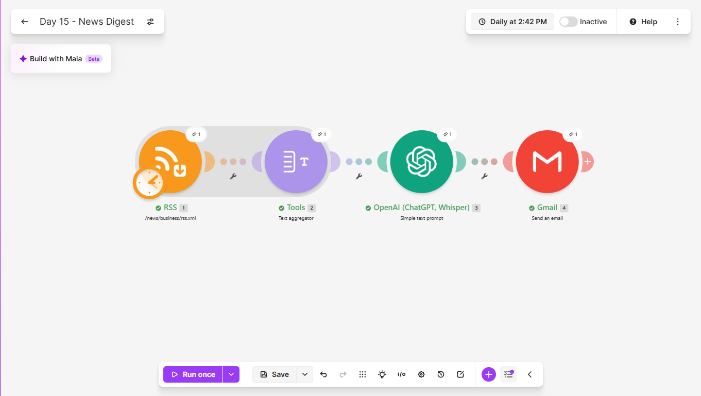
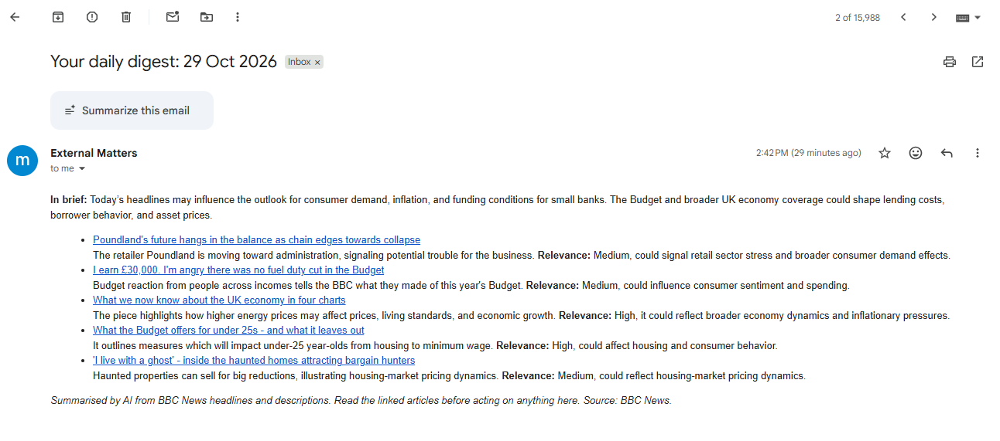
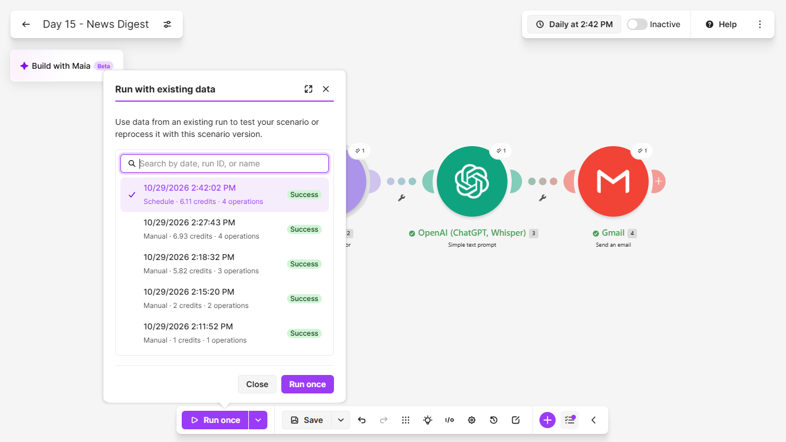

# Day 15: Daily News Digest

## The problem
Keeping up with the news that matters means opening a dozen sites,
and most people stop. The stories that affect your work get missed,
and the ones that do get read are the ones that happen to be in front
of you.

## The solution
A Make.com scenario that reads a news feed once a day and emails a
short digest written for one specific reader: the CEO of a small
tier II bank. It:
1. Reads the five latest items from the BBC Business RSS feed
2. Combines each item's title, description and link into one block
3. Sends that block to an AI model with a defined reader and strict
   rules
4. Gets back a finished HTML digest with an "In brief" paragraph and
   one entry per story
5. Emails the digest with a footer saying it is AI-written, naming the
   source, and asking the reader to read the linked articles before
   acting

Each story entry has the headline as a link back to the source, a
one or two sentence summary in the model's own words, and a relevance
rating of High, Medium or Low with a short hedged reason.

Design rules built into the prompt:
- The model may only use facts in each story's title and description
- Every story links to its own source
- It never gives investment, legal or regulatory advice
- It is a personal reading aid. It summarises and credits the source,
  and it does not republish articles

## Tools used
Make.com, RSS, OpenAI (GPT-5 nano), Gmail

## Scenario flow

## Result
The digest as it arrives in the inbox:

## Proof it runs unattended
The History tab shows a scheduled run that I did not start by hand:

## How the prompt changed
The first version produced clean HTML with no stray formatting, all
five stories, working links and the stories ordered by relevance. It
also had four problems:
- The relevance ratings were generous. One retailer's troubles was
  rated High for a bank CEO, and one person's opinion piece was rated
  Medium.
- The "In brief" paragraph stated a link between a retailer and
  lending as fact, while the rest of the digest was hedged.
- Each headline ran straight into its summary with no break.
- The audience line did not say which country the reader is in, while
  the feed is UK-based.

The second version added:
- A rule defining each rating. High only if the story is directly
  about banks, interest rates, credit, inflation or the wider economy.
  A story about one company or one person's opinion is at most Medium.
  A story with no link to banking or the economy is Low.
- A rule that every claim about banks or lending in the "In brief"
  paragraph must be hedged
- A line break after each headline link

## Lessons learned
- A rating scale needs definitions. Asking for High, Medium or Low
  invites a small model to find a banking angle in everything. Saying
  what each level means gives it something to judge against.
- Asking for finished HTML instead of JSON skips a Parse JSON module,
  which saves an operation on every run. The trade-off is less control
  over the structure of the output.
- A claim stated as fact slipped into the summary paragraph while the
  rest of the digest was hedged. Hedging has to be a rule for every
  part of the output, not a general tone.
- A Text aggregator turns five separate items into one block, so the
  model reads everything in a single call and the digest can be ranked
  across stories.
- A story with no link to banking was rated Low with a plain reason,
  which is the behaviour I wanted.
- The audience line decides what "relevant" means, so it needs to say
  where the reader is, not only what they do.
- With very little of my monthly operations allowance left, I limited
  the feed to five items, tested sparingly, scheduled a single run ten
  minutes ahead to confirm it fired on its own, and switched the
  scenario off.

## Known limitations
- The scenario has no memory of what it has already sent. On a slow
  news day, the latest five stories can repeat yesterday's digest.
- It reads one feed, and only each story's title and description, not
  the full article. The summaries are shallow by design.
- The relevance rating is the model's judgement, not a measurement,
  and it needs a human read.
- The digest is only as good as the feed's own summaries.
- It is AI-written. The reader should open the linked articles before
  acting on anything in it, and it must not be used as the basis for
  investment, legal or regulatory decisions.
- Publishers set terms for their feeds. Check them before using a feed
  commercially or republishing the digest.

## What I'd add next
- Remember the links already sent, so a story never appears twice
- Merge several feeds and let the model choose the top five
- Keep a list of topics in a sheet so the reader can change them
  without touching the scenario
- A weekly roundup built from the daily digests
- Send the digest to a team chat as well as email

## Setup
Import `news-digest.json` into Make and reconnect your own OpenAI and
Gmail accounts. Replace the feed address with your own, set the item
limit, and rewrite the audience and the topics they care about in the
prompt, including where the reader is based. Set the schedule to once
a day.
