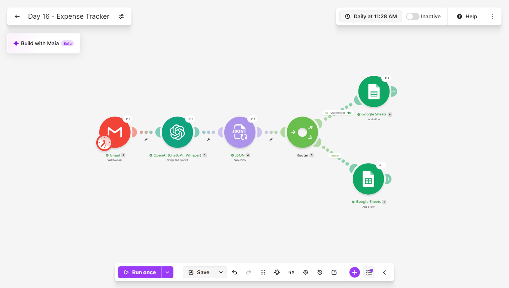
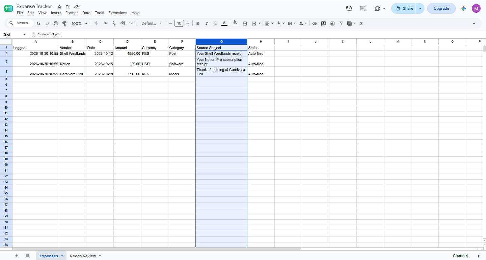
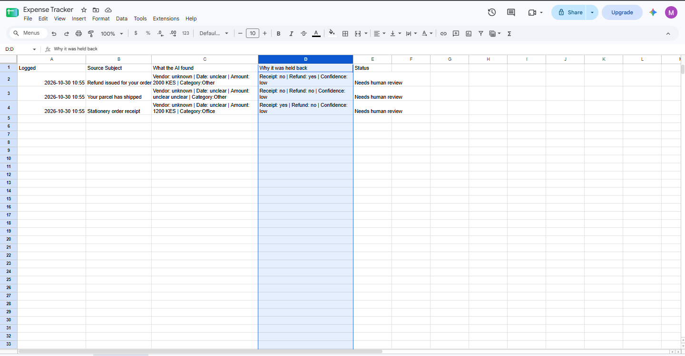
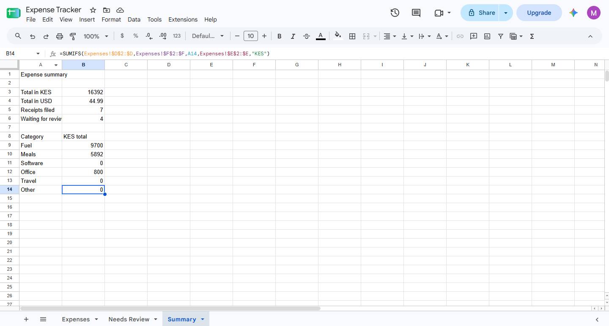
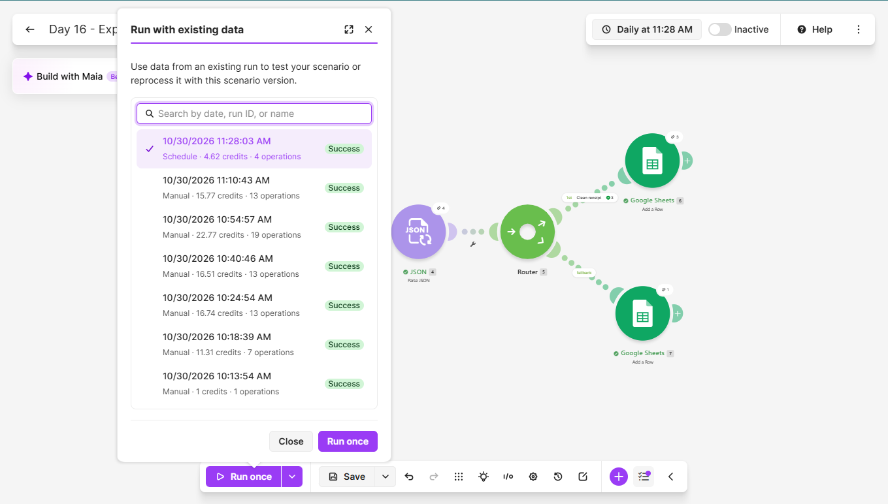
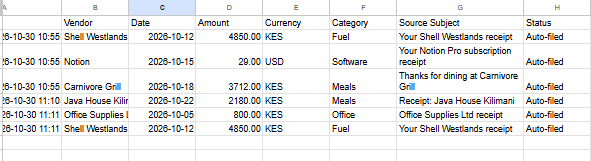
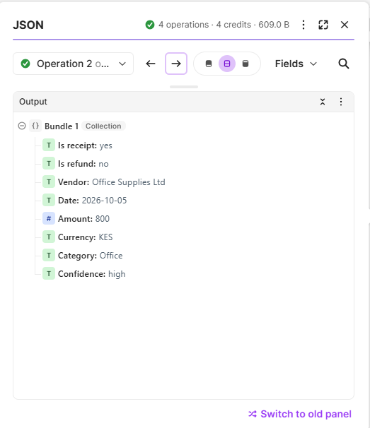

# Day 16: Receipt Expense Tracker

## The problem
Receipts pile up in an inbox, and month-end expense reports take
hours of retyping vendors, dates and amounts. When the retyping is
rushed, totals go wrong and nobody notices.

## The solution
A Make.com scenario that reads receipt emails and files the clear ones
automatically. It:
1. Watches emails carrying a "Receipts" label
2. Sends the subject and body to an AI model, which reports the
   vendor, date, amount, currency and category, whether the email is
   a receipt or a refund, and how confident it is
3. Parses that single JSON answer into separate fields
4. Checks seven conditions in the workflow before trusting the result
5. Files a clean receipt in an Expenses tab
6. Sends everything else to a Needs Review tab, with what the AI found
   and why it was held back

A Summary tab totals the expenses per currency and per category.

The AI is told never to guess. If something is not stated it writes
"unclear", and the workflow, not the model, decides what is trusted.

## Tools used
Make.com, Gmail, OpenAI (GPT-5 nano), Google Sheets

## Scenario flow

## Result
The first batch was six test emails, each built to test something
different. Three were filed:

Three were held back for a person to check:

The summary, with totals kept per currency:

## Proof it runs unattended
The History tab shows a scheduled run that I did not start by hand:

## Tests
First batch (all fictional):

| Email | What it tested | Result |
|-------|----------------|--------|
| Fuel receipt | A plain case | Filed |
| Software subscription in dollars | A foreign currency | Filed, currency kept as USD |
| Restaurant receipt with subtotal, tax and total | Picking the right amount | Filed with the final total, not the subtotal or the tax |
| Refund notice | Money coming back | Held for review |
| Parcel shipping notice | Not a receipt at all | Held for review |
| Stationery order dated 03/11/2026 | An ambiguous date | Held for review, with the date marked unclear |

Second batch, aimed at harder cases:

| Email | What it tested | Result |
|-------|----------------|--------|
| Coffee receipt with a subtotal, a service charge, a tip and a total | Picking the right amount | Filed with the final total of 2,180 |
| Receipt with an instruction hidden in the email text, telling the system to record a different amount and category | Prompt injection | The instruction was ignored. Filed as 800 KES, Office |
| Receipt identical to one already filed | Duplicates | Filed a second time |

The Expenses tab after the second batch. The identical fuel receipt
appears twice:

The parsed result for the receipt with the hidden instruction. The
amount and category came from the receipt itself:

## Lessons learned
- Let the AI say it does not know. The prompt allows "unclear" for
  every field, and the workflow refuses to file anything unclear. The
  ambiguous date was held back instead of guessed, which matters
  because a wrong date lands silently in the wrong month.
- Validation belongs in the workflow. Seven filter conditions (is a
  receipt, is not a refund, high confidence, and a vendor, date,
  amount and currency that are all known) decide what gets filed. The
  model reports, and the filter decides.
- A fallback route catches everything the clean route does not, so a
  case nobody thought of ends up in review and not in the books.
- A receipt with several amounts is a classic extraction error. The
  prompt says to use the final total, not a subtotal or a tax line, and
  both the restaurant receipt and a coffee receipt with a service charge
  and a tip were filed with their totals.
- The amount is parsed as text so that "unclear" cannot break the
  parser, and the sheet formats it as a number.
- Totals are kept per currency. Adding Kenyan shillings to dollars
  would give a number that means nothing.
- Email text is untrusted input. The prompt tells the model to ignore
  instructions written inside an email, and in the test a receipt with
  a hidden instruction was filed with its real amount and category.
- The free plan allows two active scenarios at a time, so finished
  scenarios are switched off after testing.

## Known limitations
- A receipt that is sent twice is filed twice. There is no duplicate
  check, and in the test an identical receipt was filed a second time.
- Only the text of an email is read. Receipts that arrive as a PDF or
  a photo are not processed.
- A small model can still misread a date or a total, so a person has to
  check the Needs Review tab, and spot-check the Expenses tab.
- Receipts are sensitive. The email text is sent to an AI provider, so
  real use needs a provider and data terms chosen for it.
- The "Receipts" label is applied by hand. A Gmail filter could do it
  automatically.
- A refund is held for review and never subtracted from the totals.

## What I'd add next
- A duplicate check on vendor, date and amount
- Read PDF and photo receipts
- Convert foreign currencies at the day's rate
- Subtract refunds against the original expense
- A monthly summary email

## Setup
Import `expense-tracker.json` into Make and reconnect your own Gmail,
OpenAI and Google Sheets accounts. Create a Gmail label named
"Receipts". Create a sheet with an Expenses tab (Logged, Vendor, Date,
Amount, Currency, Category, Source Subject, Status), a Needs Review tab
(Logged, Source Subject, What the AI found, Why it was held back,
Status) and a Summary tab of SUMIFS formulas. Apply the label to the
emails you want read, point the modules at your own sheet, and set the
schedule.
