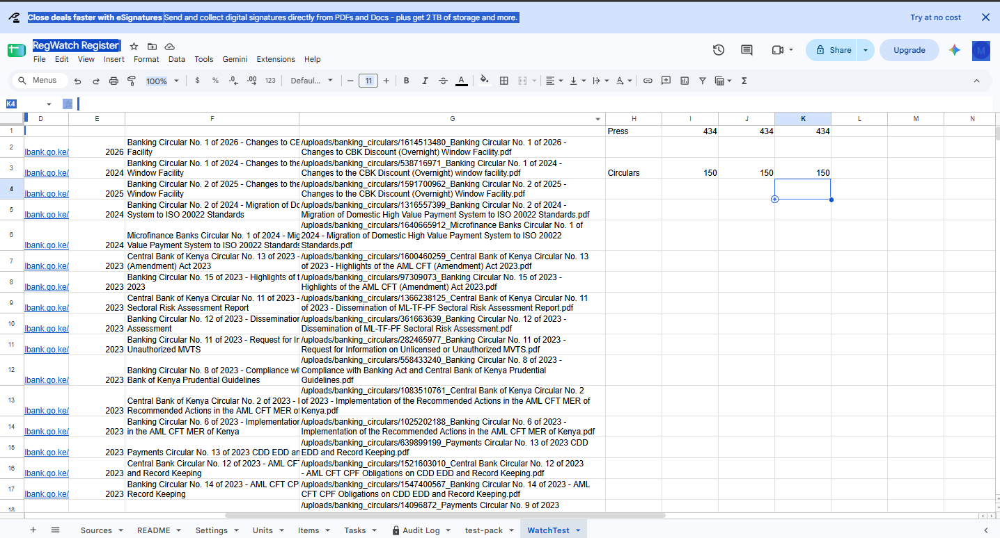
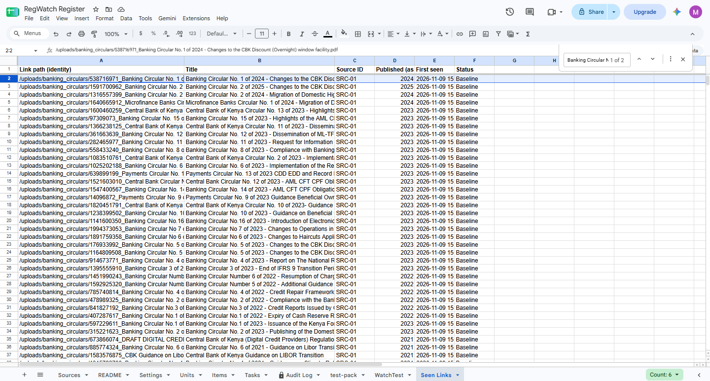
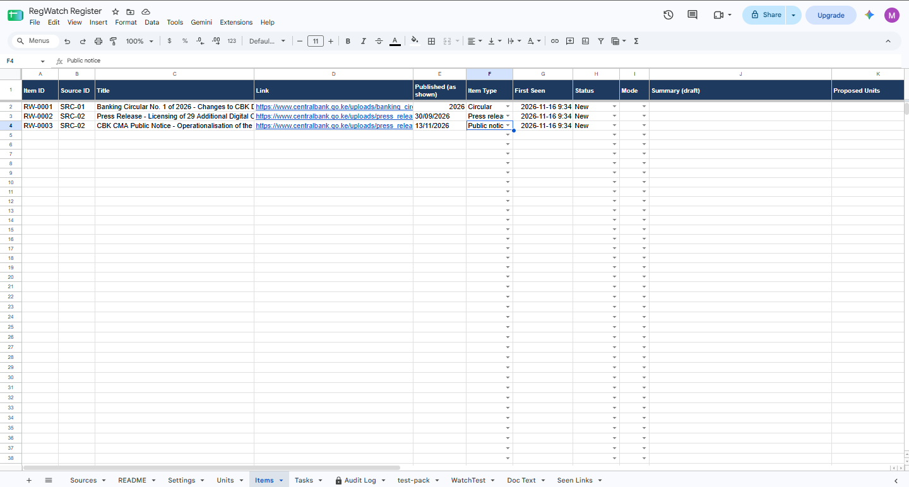
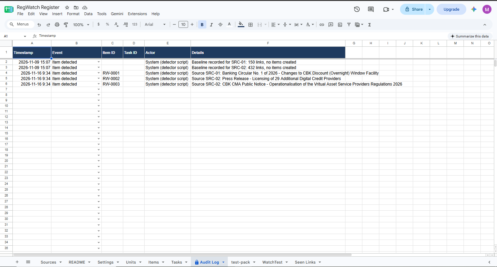
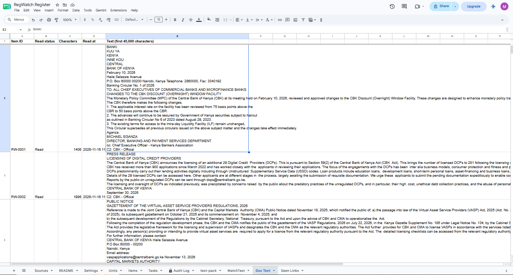
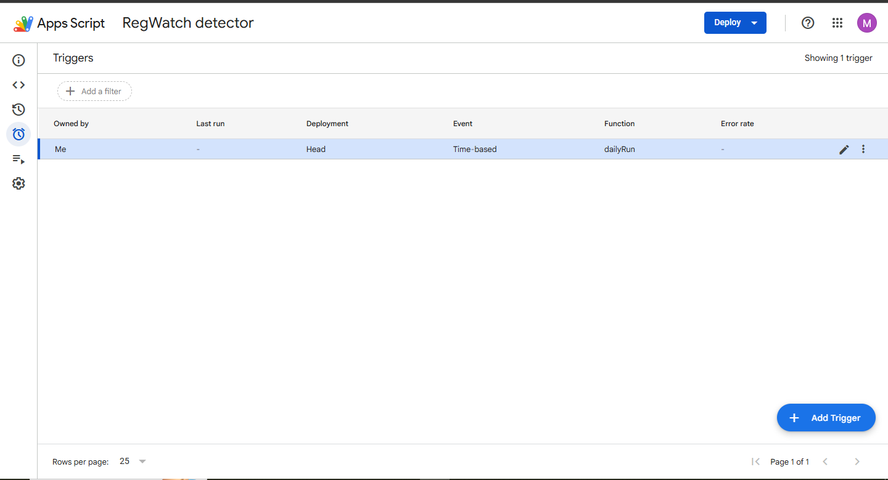
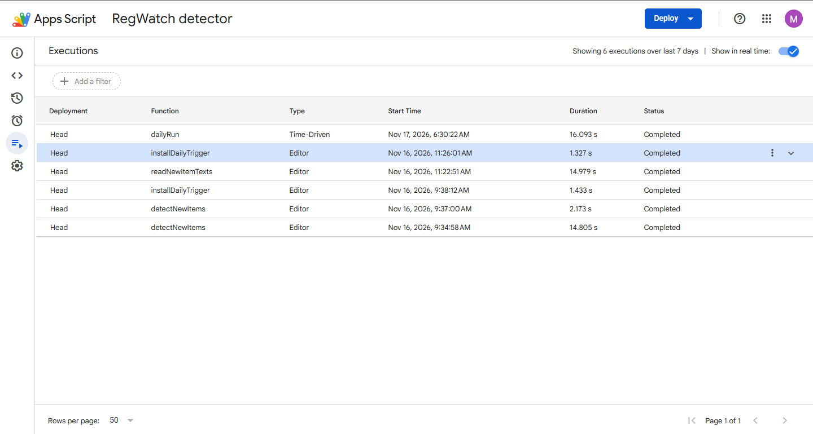
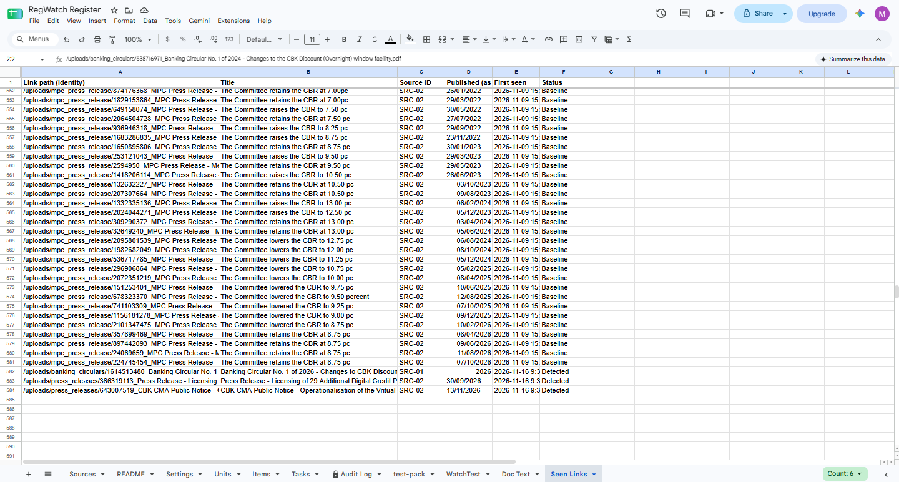
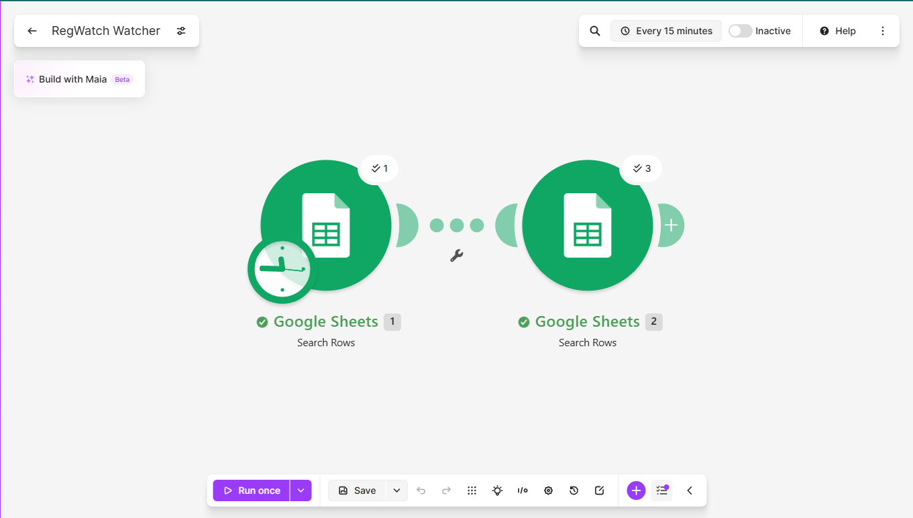

# RegWatch, Day 2: The Watcher

Make credits used: about 4, from one test run, against a budget of 30. The
detection and document reading ran in a free Google Apps Script and used
no Make credits. The Make dashboard showed 332.29 credits at the start of
the day, and the monthly allowance reset to 1,000 before the first Make run.

## What I built
The detection side of RegWatch, which finds new regulatory items and reads
them.

1. A script that fetches both Central Bank of Kenya pages every morning and
   records any link it has not seen before
2. A first run that only records a **baseline**, so history is never
   processed
3. A register row and an audit log line for every new item
4. A step that reads each new item's PDF into plain text, using Google
   Drive's free PDF conversion
5. A Make scenario that reads the new items and their text from the
   register, as a test of the handoff to Day 3

The script is in this folder as `detector.gs`.

## The decision: detection moved out of Make
My plan was for Make to fetch each page and pick out the links. But the
pages hold hundreds of rows, and on the free plan every row Make handles
costs a credit.

A spreadsheet formula can read a web page for free, so I tested that first.
It worked, and it read the **whole** lists, not just the first page of each
table: 434 rows on the press releases page and 150 on the circulars page,
with matching counts for dates, titles and links.

But imported data is cached, and other users report that it does not refresh
reliably when nobody has the sheet open. A compliance tool cannot depend on
that, so I moved detection into a Google Apps Script on a daily timer. It is
free, it runs whether or not the sheet is open, and Make only has to read the
register.

The result is a deliberate hybrid. The script does the cheap, high-volume
work of fetching pages and reading PDFs, and Make is kept for the AI and the
workflow.

## How it works
- **Identity is the link.** The circulars page shows only a year, and three
  different circulars share almost the same title, so a title or a date
  cannot tell me what is new. A link can.
- **The first run records a baseline** and creates no items. The page held
  150 circulars and 432 press releases and notices.
- **A new link** becomes an Items row (RW-0001 and so on) with the status
  New, and an Audit Log line.
- **Guards:** a page with no rows, or with more than 25 new links at once,
  adds nothing and writes an error to the Audit Log. A lock stops two runs
  from overlapping, and a link that appears twice on a page is counted once.
- **Reading a document:** the script downloads the PDF, converts it to a
  temporary Google Doc, reads the text, and deletes the Doc. Text goes to a
  Doc Text tab marked **Read**, or **Not read** with the reason. A document
  that cannot be read is never summarised from its title.

## Results
| Check | Result |
|-------|--------|
| First run | 150 circular links and 432 press and notice links recorded as a baseline, with no items created |
| Simulated new items | I deleted two links from the seen list. The next run found both as RW-0001 and RW-0002, with Audit Log lines |
| A third run | Added nothing, so there are no duplicates |
| A real new item | RW-0003, a public notice dated 13 November 2026, published after my baseline, was found by the script |
| Documents read | All three. RW-0001 gave 1,406 characters and RW-0002 gave 1,986 |
| First scheduled run | `dailyRun`, time-driven, 17 November 2026 at 06:30, 16.1 seconds, completed |

The Make test scenario used two Google Sheets searches. The first returned the
three items with the status New. The second returned each item's document
text, one lookup per item, and the full text came through intact.

## What the real text changed
Reading the documents was more useful than reading the titles:
- **RW-0001** is a banking circular that lowers the interest rate on the
  central bank's overnight discount window from 75 to 50 basis points above
  the policy rate, and says the changes take effect immediately. So it has
  **no deadline** for the system to find.
- **RW-0002** is a press release announcing the licensing of 29 more digital
  credit providers. It is information and not an obligation.
- **RW-0003** is a notice gazetting regulations for virtual asset service
  providers. It only applies to a bank that provides those services, so the
  correct answer for a bank that does not is "unclear", not a confident yes.

The answer key, which I wrote from titles alone, gets corrected against these
texts at the start of Day 3.

## Problems found
- **My item-type classifier missed a real item.** It matched only titles that
  began with "Public Notice", so "CBK CMA Public Notice" was filed as "Other".
  It now matches the phrase anywhere in the title.
- **The letterhead text is noisy.** A logo became garbage characters, but the
  body of the document read cleanly, so the loss is cosmetic.
- **The press releases page is mixed.** Alongside regulatory notices it holds
  the Monetary Policy Committee's rate decisions, which makes a useful extra
  test case.
- **The script found 432 links on the press page where the formula counted
  434.** I believe two entries share a link, which the script counts once, but
  I have not confirmed it.

## Lessons learned
- A formula can look like a free detector and still fail unattended. Test the
  unattended behaviour and not just a manual run.
- Put high-volume work in the cheapest reliable tool, and use Make where it
  earns its credits.
- The first run should record a baseline, or the system drowns in history.
- Convert a PDF once, for free, and pass on text. If there is no text, there
  is no AI call.
- Test a classifier on real titles. Mine looked fine until a real notice
  broke it.
- Read the real documents before trusting an answer key written from titles.

## Known limitations
- Two systems to maintain: the script's access is tied to one Google account.
- Scanned PDFs may not convert, and are flagged "Not read".
- The table parsing depends on the page layout. A change is caught by the
  guards and logged, but does not yet send an alert.
- A notice can take up to a day to appear, because the script runs once a day.
- Only the first 45,000 characters of a document are stored.
- Letterhead text can come out as noise.

## Next: Day 3
Correct the answer key against the real texts, then the AI step: draft a
summary, propose units and a deadline, return evidence that the workflow
checks against the document, and the rules-only fallback.
